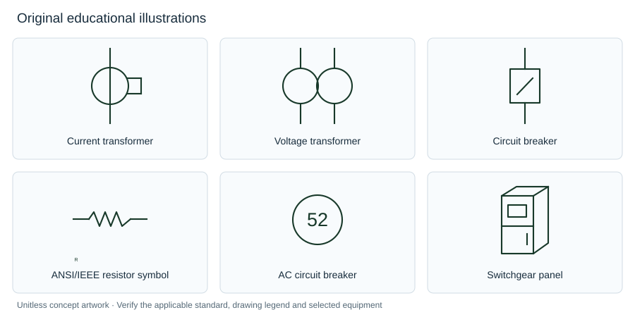

# Elora Grid Open Electrical Symbol Library

An open, source-linked reference catalogue for electrical engineers and software agents working with single line diagrams (SLDs), schematics and general arrangement (GA) drawings for switchgear, switchboards, switchrooms and microgrid power stations.

**[Browse and search the library on eloragrid.ai](https://eloragrid.ai/library)** · [ANSI / IEEE forms](https://eloragrid.ai/library/conventions/ansi-ieee) · [IEC forms](https://eloragrid.ai/library/conventions/iec) · [Drawing guides](https://eloragrid.ai/library/guides) · [Public sources](https://eloragrid.ai/library/sources)

This repository distributes independently authored explanations and original educational illustrations. It is not an official IEC or IEEE standards publication, an exhaustive standards database, a set of certified standard glyphs, or a manufacturer footprint library. Reference-family labels identify relevant context; only records with `symbolVariant` explicitly identify a particular graphical convention.

## Coverage

<!-- coverage:start -->
- **1,095 technical references**: 654 symbols/diagram references, 155 protection/device functions and 286 GA objects.
- **305 public source records**.
- **116 explicitly labelled ANSI/IEEE forms** and **149 explicitly labelled IEC forms** within the symbol records.
- **6,095 public manufacturer CAD file listings**, counted separately.
- One SVG per entry and one original DXF concept-block pack.
- Editorial/source review date: **2026-10-14**; package version: **1.0.0**.
<!-- coverage:end -->

File listings are links and filenames, not hosted manufacturer CAD, verified product-model counts or additional unique symbols. Multiple records can share a generic illustration. [Coverage and limitations](docs/coverage.md).



## Quick start

No account or API key is required to read the data. Download a release or clone this repository:

```sh
git clone https://github.com/elora-grid/electrical-symbol-library.git
cd electrical-symbol-library
node scripts/query.mjs "current transformer" --limit 5
node scripts/query.mjs "resistor" --convention ansi-ieee
node scripts/query.mjs "52" --kind function
node scripts/query.mjs --id current-transformer
```

The query command uses Node.js built-ins. To validate or regenerate the distribution:

```sh
npm ci
npm run check
npm run build
```

## Files for agents and integrations

| File | Purpose |
| --- | --- |
| [`data/index.json`](data/index.json) | Compact search records and per-entry file paths. Start here. |
| [`entries/current-transformer.json`](entries/current-transformer.json) | A complete record with resolved public sources and its Elora reference URL. |
| [`data/catalogue.json`](data/catalogue.json) | Complete bulk catalogue and source registry. |
| [`data/manufacturer-cad.json`](data/manufacturer-cad.json) | Public manufacturer file listings; follow publisher links for actual files. |
| [`artwork/svg/`](artwork/svg/) | Original SVG concept illustrations, one per reference record. |
| [`artwork/electrical-reference-library.dxf`](artwork/electrical-reference-library.dxf) | Original R12 DXF concept blocks, unitless and not to scale. |
| [`schema/`](schema/) | JSON Schemas for catalogue and CAD metadata. |
| [`manifest.json`](manifest.json) | Release version, counts and SHA-256 checksums. |
| [`llms.txt`](llms.txt) | Short machine-readable starting points. |

Use an entry's `canonicalUrl` when citing its definition. That field expresses the publisher's preferred citation destination; it is not an instruction that overrides an agent's user or an HTML canonical tag on GitHub. Use the underlying `references` and `publicSources` for technical verification.

Examples: [Node search and lookup](docs/agent-usage.md), [Python example](examples/search.py), [data format](docs/data-format.md).

## Licensing and attribution

Original catalogue prose, documentation, dataset compilation and original artwork: **CC BY 4.0**, to the extent Elora Grid holds the applicable rights. Scripts, tests and schemas: **MIT**. See [licensing scope](ATTRIBUTION.md), [CC BY 4.0](LICENSE) and [MIT](LICENSES/MIT.txt).

Referenced standards, manufacturer drawings, publisher filenames, trademarks and linked resources retain their respective rights. No third-party materials or rights are conveyed by this release. [Provenance](docs/provenance.md).

Suggested attribution: “Elora Grid Open Electrical Symbol Library, version 1.0.0, https://eloragrid.ai/library, CC BY 4.0.” Indicate modifications when applicable. [`CITATION.cff`](CITATION.cff) supplies a dataset citation; it does not guarantee that an AI service will provide attribution.

## Updates and contributions

The public Elora catalogue is the editorial source. `npm run sync` refreshes the snapshot from the documented public Elora exports, then regenerates the derived files. It does not publish or push changes. Review the diff, run `npm run check`, update the version/changelog and tag a release. Both website and repository distributions therefore come from the same public catalogue; this repository may lag between releases.

Corrections are welcome with public primary evidence. See [CONTRIBUTING.md](CONTRIBUTING.md). Detailed guides and the interactive comparison, legend and search tools are available at **[eloragrid.ai/library](https://eloragrid.ai/library)**.
