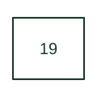

# Starting-to-running transition contactor

Changes the machine connection from its starting arrangement to its running arrangement.

[Canonical reference](https://eloragrid.ai/protection-functions/19-starting-to-running-transition-contactor) · [Structured record](../entries/19-starting-to-running-transition-contactor.json) · [All references](README.md)

Updated: 2026-10-27. Drawing use: SLD, Schematic. Reference families: IEEE / ANSI.

## What it represents

Changes the machine connection from its starting arrangement to its running arrangement.
In a drafting package, connect this reference to the starting and running power connections. The associated drawing should trace the transition coil and interlocked contactors; the number identifies the role and does not specify the terminal arrangement, ratings or operating settings.

## How to read it

- Identify the starting and running power connections.
- Trace the transition coil and interlocked contactors.

## Drawing checklist

- Label the starting and running power connections.
- Cross-reference the transition coil and interlocked contactors.
- Identify the device tag, manual revision and logic drawing that define this implementation.

## Important distinction

A transition contactor changes the starting arrangement; it is not a generic reversing contactor.

## Facts

- ANSI / IEEE function number: 19
- Drawing context: The starting and running power connections
- Application scope: Protection or apparatus-control role; exact implementation is defined by the equipment documentation.

## Public references

- [ANSI device-number and suffix reference table](https://selinc.com/pt/products/tables/ansi/) — Schweitzer Engineering Laboratories. Public manufacturer number/name association. Drafting explanations are independently written.
- [IEEE C37.2-2022: power-system device function numbers](https://ieeexplore.ieee.org/document/9984140) — IEEE. Normative device-number publication; exact edition wording and compliance require the licensed standard.

## Related references

- [Contactor](contactor.md)
- [AC circuit breaker](52-ac-circuit-breaker.md)

Original educational concept geometry, CC BY 4.0. Unitless; not a certified standards glyph or manufacturer footprint.

Elora-authored explanations are CC BY 4.0. Linked standards and manufacturer material retain their own rights. Confirm project requirements using primary sources.
