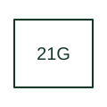

# Ground distance protection

Evaluates a distance characteristic for a phase-to-earth fault loop.

[Canonical reference](https://eloragrid.ai/protection-functions/21g-ground-distance-protection) · [Structured record](../entries/21g-ground-distance-protection.json) · [All references](README.md)

Updated: 2026-10-27. Drawing use: SLD, Schematic. Reference families: IEEE / ANSI, Manufacturer.

## What it represents

Evaluates a distance characteristic for a phase-to-earth fault loop.
The drafting record should connect this function to the phase and residual current references, VT circuit and protected line, then trace the ground distance zones and earth-loop compensation reference. Keep the complete designation and equipment tag together so that the SLD, relay logic and terminal schedule describe the same implementation.
The cited mapping is a public manufacturer example (SEL line protection documentation). Suffixes are not universal equivalences across products, and this reference supplies neither a protection setting nor certification of the selected scheme.

## How to read it

- Identify the phase and residual current references, VT circuit and protected line.
- Trace the ground distance zones and earth-loop compensation reference.

## Drawing checklist

- Label the phase and residual current references, VT circuit and protected line.
- Cross-reference the ground distance zones and earth-loop compensation reference.
- Retain the complete suffix, selected device tag and manufacturer manual revision.

## Important distinction

Ground distance includes the ground-loop measurement treatment; it is not simply phase distance with a different alarm label.

## Facts

- Function designation: 21G
- Base function: 21 — Distance protection
- Published mapping: SEL line protection documentation
- Suffix scope: Application or manufacturer specific; check the complete drawing legend and selected device manual.

## Public references

- [SEL 2022 Product and Solution Guide: published protection function tables](https://selinc.com/api/download/136012) — Schweitzer Engineering Laboratories. Explicit public manufacturer mapping of 21P to phase distance and 21G to ground distance in the protection feature tables.
- [SEL-321 phase and ground distance relay documentation](https://selinc.com/products/321/docs/) — Schweitzer Engineering Laboratories. Public primary-source function or application mapping used to identify this designation; wording and drafting notes are original.
- [IEEE C37.2-2022: power-system device function numbers](https://ieeexplore.ieee.org/document/9984140) — IEEE. Device-number and suffix convention. This page is not a reproduction of the full licensed standard.

## Related references

- [Distance protection](21-distance-protection.md)
- [Current transformer](current-transformer.md)

Original educational concept geometry, CC BY 4.0. Unitless; not a certified standards glyph or manufacturer footprint.

Elora-authored explanations are CC BY 4.0. Linked standards and manufacturer material retain their own rights. Confirm project requirements using primary sources.
