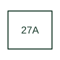

# Auxiliary-input undervoltage protection

Supervises low voltage using the auxiliary voltage input identified by the selected relay.

[Canonical reference](https://eloragrid.ai/protection-functions/27a-auxiliary-input-undervoltage-protection) · [Structured record](../entries/27a-auxiliary-input-undervoltage-protection.json) · [All references](README.md)

Updated: 2026-10-27. Drawing use: SLD, Schematic. Reference families: IEEE / ANSI, Manufacturer.

## What it represents

Supervises low voltage using the auxiliary voltage input identified by the selected relay.
The drafting record should connect this function to the auxiliary VT or voltage input and its phase assignment, then trace the auxiliary undervoltage output and any closing permission. Keep the complete designation and equipment tag together so that the SLD, relay logic and terminal schedule describe the same implementation.
The cited mapping is a public manufacturer example (Eaton ETR family). Suffixes are not universal equivalences across products, and this reference supplies neither a protection setting nor certification of the selected scheme.

## How to read it

- Identify the auxiliary VT or voltage input and its phase assignment.
- Trace the auxiliary undervoltage output and any closing permission.

## Drawing checklist

- Label the auxiliary VT or voltage input and its phase assignment.
- Cross-reference the auxiliary undervoltage output and any closing permission.
- Retain the complete suffix, selected device tag and manufacturer manual revision.

## Important distinction

In the cited Eaton family, A distinguishes the auxiliary measurement input; it is not a universal alarm-only suffix.

## Facts

- Function designation: 27A
- Base function: 27 — Undervoltage
- Published mapping: Eaton ETR family
- Suffix scope: Application or manufacturer specific; check the complete drawing legend and selected device manual.

## Public references

- [ETR-4000 and ETR-5000 transformer protection function tables](https://www.eaton.com/us/en-us/catalog/electrical-circuit-protection/transformer-relays.html) — Eaton. Public primary-source function or application mapping used to identify this designation; wording and drafting notes are original.
- [IEEE C37.2-2022: power-system device function numbers](https://ieeexplore.ieee.org/document/9984140) — IEEE. Device-number and suffix convention. This page is not a reproduction of the full licensed standard.

## Related references

- [Undervoltage](27-undervoltage.md)
- [Voltage transformer](voltage-transformer.md)

Original educational concept geometry, CC BY 4.0. Unitless; not a certified standards glyph or manufacturer footprint.

Elora-authored explanations are CC BY 4.0. Linked standards and manufacturer material retain their own rights. Confirm project requirements using primary sources.
