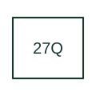

# Reactive-power undervoltage protection

Combines a reactive-power criterion with undervoltage supervision in the cited interconnection application.

[Canonical reference](https://eloragrid.ai/protection-functions/27q-reactive-power-undervoltage-protection) · [Structured record](../entries/27q-reactive-power-undervoltage-protection.json) · [All references](README.md)

Updated: 2026-10-27. Drawing use: SLD, Schematic. Reference families: IEEE / ANSI, Manufacturer.

## What it represents

Combines a reactive-power criterion with undervoltage supervision in the cited interconnection application.
The drafting record should connect this function to the voltage and current inputs and defined reactive-power direction, then trace the combined reactive-power and undervoltage operating logic. Keep the complete designation and equipment tag together so that the SLD, relay logic and terminal schedule describe the same implementation.
The cited mapping is a public manufacturer example (Eaton ETR family). Suffixes are not universal equivalences across products, and this reference supplies neither a protection setting nor certification of the selected scheme.

## How to read it

- Identify the voltage and current inputs and defined reactive-power direction.
- Trace the combined reactive-power and undervoltage operating logic.

## Drawing checklist

- Label the voltage and current inputs and defined reactive-power direction.
- Cross-reference the combined reactive-power and undervoltage operating logic.
- Retain the complete suffix, selected device tag and manufacturer manual revision.

## Important distinction

27Q is an Eaton application designation; ABB separately labels a related function 32Q,27, so retain the device-specific legend.

## Facts

- Function designation: 27Q
- Base function: 27 — Undervoltage
- Published mapping: Eaton ETR family
- Suffix scope: Application or manufacturer specific; check the complete drawing legend and selected device manual.

## Public references

- [ETR-4000 and ETR-5000 transformer protection function tables](https://www.eaton.com/us/en-us/catalog/electrical-circuit-protection/transformer-relays.html) — Eaton. Public primary-source function or application mapping used to identify this designation; wording and drafting notes are original.
- [IEEE C37.2-2022: power-system device function numbers](https://ieeexplore.ieee.org/document/9984140) — IEEE. Device-number and suffix convention. This page is not a reproduction of the full licensed standard.

## Related references

- [Undervoltage](27-undervoltage.md)
- [Voltage transformer](voltage-transformer.md)

Original educational concept geometry, CC BY 4.0. Unitless; not a certified standards glyph or manufacturer footprint.

Elora-authored explanations are CC BY 4.0. Linked standards and manufacturer material retain their own rights. Confirm project requirements using primary sources.
