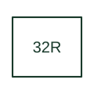

# Reverse-power protection

Detects active power flowing opposite to the defined generator or circuit direction.

[Canonical reference](https://eloragrid.ai/protection-functions/32r-reverse-power-protection) · [Structured record](../entries/32r-reverse-power-protection.json) · [All references](README.md)

Updated: 2026-10-27. Drawing use: SLD, Schematic. Reference families: IEEE / ANSI, Manufacturer.

## What it represents

Detects active power flowing opposite to the defined generator or circuit direction.
The drafting record should connect this function to the generator CT/VT inputs and the defined export direction, then trace the reverse-power alarm or generator trip path. Keep the complete designation and equipment tag together so that the SLD, relay logic and terminal schedule describe the same implementation.
The cited mapping is a public manufacturer example (ABB Relion 620 function mapping). Suffixes are not universal equivalences across products, and this reference supplies neither a protection setting nor certification of the selected scheme.

## How to read it

- Identify the generator CT/VT inputs and the defined export direction.
- Trace the reverse-power alarm or generator trip path.

## Drawing checklist

- Label the generator CT/VT inputs and the defined export direction.
- Cross-reference the reverse-power alarm or generator trip path.
- Retain the complete suffix, selected device tag and manufacturer manual revision.

## Important distinction

Reverse active power 32R differs from reactive-power flow 32V and must be distinguished in the trip schedule.

## Facts

- Function designation: 32R
- Base function: 32 — Directional power
- Published mapping: ABB Relion 620 function mapping
- Suffix scope: Application or manufacturer specific; check the complete drawing legend and selected device manual.

## Public references

- [Relion 620 series: published protection function and designation mappings](https://techdoc.relays.protection-control.abb/r/620-series-IEC-60870-5-103-Point-List-Manual/2.0-FP1-IEC/en-US/Functions-codes-and-symbols) — ABB. Public primary-source function or application mapping used to identify this designation; wording and drafting notes are original.
- [IEEE C37.2-2022: power-system device function numbers](https://ieeexplore.ieee.org/document/9984140) — IEEE. Device-number and suffix convention. This page is not a reproduction of the full licensed standard.

## Related references

- [Directional power](32-directional-power.md)
- [Current transformer](current-transformer.md)

Original educational concept geometry, CC BY 4.0. Unitless; not a certified standards glyph or manufacturer footprint.

Elora-authored explanations are CC BY 4.0. Linked standards and manufacturer material retain their own rights. Confirm project requirements using primary sources.
