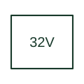

# Directional reactive-power protection

Supervises forward or reverse reactive power using the selected relay's power-direction convention.

[Canonical reference](https://eloragrid.ai/protection-functions/32v-directional-reactive-power-protection) · [Structured record](../entries/32v-directional-reactive-power-protection.json) · [All references](README.md)

Updated: 2026-10-27. Drawing use: SLD, Schematic. Reference families: IEEE / ANSI, Manufacturer.

## What it represents

Supervises forward or reverse reactive power using the selected relay's power-direction convention.
The drafting record should connect this function to the CT/VT measurement pairs and reactive-power sign reference, then trace the reactive-power alarm or operating output. Keep the complete designation and equipment tag together so that the SLD, relay logic and terminal schedule describe the same implementation.
The cited mapping is a public manufacturer example (Eaton ETR family). Suffixes are not universal equivalences across products, and this reference supplies neither a protection setting nor certification of the selected scheme.

## How to read it

- Identify the CT/VT measurement pairs and reactive-power sign reference.
- Trace the reactive-power alarm or operating output.

## Drawing checklist

- Label the CT/VT measurement pairs and reactive-power sign reference.
- Cross-reference the reactive-power alarm or operating output.
- Retain the complete suffix, selected device tag and manufacturer manual revision.

## Important distinction

In the cited Eaton devices 32V denotes VAR protection; V is not a universal indication of a voltage-only function.

## Facts

- Function designation: 32V
- Base function: 32 — Directional power
- Published mapping: Eaton ETR family
- Suffix scope: Application or manufacturer specific; check the complete drawing legend and selected device manual.

## Public references

- [ETR-4000 and ETR-5000 transformer protection function tables](https://www.eaton.com/us/en-us/catalog/electrical-circuit-protection/transformer-relays.html) — Eaton. Public primary-source function or application mapping used to identify this designation; wording and drafting notes are original.
- [IEEE C37.2-2022: power-system device function numbers](https://ieeexplore.ieee.org/document/9984140) — IEEE. Device-number and suffix convention. This page is not a reproduction of the full licensed standard.

## Related references

- [Directional power](32-directional-power.md)
- [Current transformer](current-transformer.md)

Original educational concept geometry, CC BY 4.0. Unitless; not a certified standards glyph or manufacturer footprint.

Elora-authored explanations are CC BY 4.0. Linked standards and manufacturer material retain their own rights. Confirm project requirements using primary sources.
