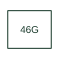

# Generator current-unbalance protection

Supervises generator current imbalance using the manufacturer's machine protection implementation.

[Canonical reference](https://eloragrid.ai/protection-functions/46g-generator-current-unbalance-protection) · [Structured record](../entries/46g-generator-current-unbalance-protection.json) · [All references](README.md)

Updated: 2026-10-27. Drawing use: SLD, Schematic. Reference families: IEEE / ANSI, Manufacturer.

## What it represents

Supervises generator current imbalance using the manufacturer's machine protection implementation.
The drafting record should connect this function to the generator's three phase-current measurements, then trace the generator unbalance alarm or trip function. Keep the complete designation and equipment tag together so that the SLD, relay logic and terminal schedule describe the same implementation.
The cited mapping is a public manufacturer example (Eaton EGR family). Suffixes are not universal equivalences across products, and this reference supplies neither a protection setting nor certification of the selected scheme.

## How to read it

- Identify the generator's three phase-current measurements.
- Trace the generator unbalance alarm or trip function.

## Drawing checklist

- Label the generator's three phase-current measurements.
- Cross-reference the generator unbalance alarm or trip function.
- Retain the complete suffix, selected device tag and manufacturer manual revision.

## Important distinction

46G names a generator application in the cited Eaton family; it does not universally mean ground overcurrent.

## Facts

- Function designation: 46G
- Base function: 46 — Current unbalance / negative sequence
- Published mapping: Eaton EGR family
- Suffix scope: Application or manufacturer specific; check the complete drawing legend and selected device manual.

## Public references

- [EGR-5000 generator protection: public function overview](https://www.eaton.com/us/en-us/catalog/electrical-circuit-protection/generator-relays.html) — Eaton. Public primary-source function or application mapping used to identify this designation; wording and drafting notes are original.
- [IEEE C37.2-2022: power-system device function numbers](https://ieeexplore.ieee.org/document/9984140) — IEEE. Device-number and suffix convention. This page is not a reproduction of the full licensed standard.

## Related references

- [Current unbalance / negative sequence](46-current-unbalance.md)
- [Current transformer](current-transformer.md)

Original educational concept geometry, CC BY 4.0. Unitless; not a certified standards glyph or manufacturer footprint.

Elora-authored explanations are CC BY 4.0. Linked standards and manufacturer material retain their own rights. Confirm project requirements using primary sources.
