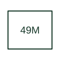

# Motor thermal-model protection

Estimates motor thermal duty using the selected relay's motor thermal model.

[Canonical reference](https://eloragrid.ai/protection-functions/49m-motor-thermal-model-protection) · [Structured record](../entries/49m-motor-thermal-model-protection.json) · [All references](README.md)

Updated: 2026-10-27. Drawing use: SLD, Schematic. Reference families: IEEE / ANSI, Manufacturer.

## What it represents

Estimates motor thermal duty using the selected relay's motor thermal model.
The drafting record should connect this function to the motor current measurements and thermal-model data reference, then trace the thermal overload trip and restart permission. Keep the complete designation and equipment tag together so that the SLD, relay logic and terminal schedule describe the same implementation.
The cited mapping is a public manufacturer example (ABB Relion 620 function mapping). Suffixes are not universal equivalences across products, and this reference supplies neither a protection setting nor certification of the selected scheme.

## How to read it

- Identify the motor current measurements and thermal-model data reference.
- Trace the thermal overload trip and restart permission.

## Drawing checklist

- Label the motor current measurements and thermal-model data reference.
- Cross-reference the thermal overload trip and restart permission.
- Retain the complete suffix, selected device tag and manufacturer manual revision.

## Important distinction

A motor thermal model is distinct from a winding thermostat or an RTD alarm channel; both can coexist.

## Facts

- Function designation: 49M
- Base function: 49 — Thermal protection
- Published mapping: ABB Relion 620 function mapping
- Suffix scope: Application or manufacturer specific; check the complete drawing legend and selected device manual.

## Public references

- [Relion 620 series: published protection function and designation mappings](https://techdoc.relays.protection-control.abb/r/620-series-IEC-60870-5-103-Point-List-Manual/2.0-FP1-IEC/en-US/Functions-codes-and-symbols) — ABB. Public primary-source function or application mapping used to identify this designation; wording and drafting notes are original.
- [IEEE C37.2-2022: power-system device function numbers](https://ieeexplore.ieee.org/document/9984140) — IEEE. Device-number and suffix convention. This page is not a reproduction of the full licensed standard.

## Related references

- [Thermal protection](49-thermal-protection.md)
- [Current transformer](current-transformer.md)

Original educational concept geometry, CC BY 4.0. Unitless; not a certified standards glyph or manufacturer footprint.

Elora-authored explanations are CC BY 4.0. Linked standards and manufacturer material retain their own rights. Confirm project requirements using primary sources.
