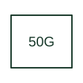

# Instantaneous ground overcurrent

Supervises the ground-current input or ground-fault quantity identified by the selected relay.

[Canonical reference](https://eloragrid.ai/protection-functions/50g-instantaneous-ground-overcurrent) · [Structured record](../entries/50g-instantaneous-ground-overcurrent.json) · [All references](README.md)

Updated: 2026-10-27. Drawing use: SLD, Schematic. Reference families: IEEE / ANSI, Manufacturer.

## What it represents

Supervises the ground-current input or ground-fault quantity identified by the selected relay.
The drafting record should connect this function to the ground CT input, earthing connection and sensor polarity, then trace the ground overcurrent trip and circuit earthing reference. Keep the complete designation and equipment tag together so that the SLD, relay logic and terminal schedule describe the same implementation.
The cited mapping is a public manufacturer example (SEL generator protection feature table). Suffixes are not universal equivalences across products, and this reference supplies neither a protection setting nor certification of the selected scheme.

## How to read it

- Identify the ground CT input, earthing connection and sensor polarity.
- Trace the ground overcurrent trip and circuit earthing reference.

## Drawing checklist

- Label the ground CT input, earthing connection and sensor polarity.
- Cross-reference the ground overcurrent trip and circuit earthing reference.
- Retain the complete suffix, selected device tag and manufacturer manual revision.

## Important distinction

G is application-dependent: in 50G it denotes ground current, while 87G commonly denotes generator differential.

## Facts

- Function designation: 50G
- Base function: 50 — Instantaneous overcurrent
- Published mapping: SEL generator protection feature table
- Suffix scope: Application or manufacturer specific; check the complete drawing legend and selected device manual.

## Public references

- [Generator protection feature and function comparison](https://selinc.com/products/comparisons/generator-protection/) — Schweitzer Engineering Laboratories. Public primary-source function or application mapping used to identify this designation; wording and drafting notes are original.
- [IEEE C37.2-2022: power-system device function numbers](https://ieeexplore.ieee.org/document/9984140) — IEEE. Device-number and suffix convention. This page is not a reproduction of the full licensed standard.

## Related references

- [Instantaneous overcurrent](50-instantaneous-overcurrent.md)
- [Current transformer](current-transformer.md)

Original educational concept geometry, CC BY 4.0. Unitless; not a certified standards glyph or manufacturer footprint.

Elora-authored explanations are CC BY 4.0. Linked standards and manufacturer material retain their own rights. Confirm project requirements using primary sources.
