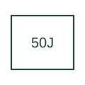

# Motor jam or stall protection

Supervises a motor current condition associated with a jam or stall in the cited relay application.

[Canonical reference](https://eloragrid.ai/protection-functions/50j-motor-jam-or-stall-protection) · [Structured record](../entries/50j-motor-jam-or-stall-protection.json) · [All references](README.md)

Updated: 2026-10-27. Drawing use: SLD, Schematic. Reference families: IEEE / ANSI, Manufacturer.

## What it represents

Supervises a motor current condition associated with a jam or stall in the cited relay application.
The drafting record should connect this function to the motor CT inputs and running/starting-state logic, then trace the jam or stall trip and reset/restart interface. Keep the complete designation and equipment tag together so that the SLD, relay logic and terminal schedule describe the same implementation.
The cited mapping is a public manufacturer example (Eaton EMR family). Suffixes are not universal equivalences across products, and this reference supplies neither a protection setting nor certification of the selected scheme.

## How to read it

- Identify the motor CT inputs and running/starting-state logic.
- Trace the jam or stall trip and reset/restart interface.

## Drawing checklist

- Label the motor CT inputs and running/starting-state logic.
- Cross-reference the jam or stall trip and reset/restart interface.
- Retain the complete suffix, selected device tag and manufacturer manual revision.

## Important distinction

A jam/stall element requires its application context; starting locked-rotor and running jam protection can use different supervision.

## Facts

- Function designation: 50J
- Base function: 50 — Instantaneous overcurrent
- Published mapping: Eaton EMR family
- Suffix scope: Application or manufacturer specific; check the complete drawing legend and selected device manual.

## Public references

- [EMR motor protection: public function comparison](https://www.eaton.com/us/en-us/catalog/electrical-circuit-protection/motor-relays.html) — Eaton. Public primary-source function or application mapping used to identify this designation; wording and drafting notes are original.
- [IEEE C37.2-2022: power-system device function numbers](https://ieeexplore.ieee.org/document/9984140) — IEEE. Device-number and suffix convention. This page is not a reproduction of the full licensed standard.

## Related references

- [Instantaneous overcurrent](50-instantaneous-overcurrent.md)
- [Current transformer](current-transformer.md)

Original educational concept geometry, CC BY 4.0. Unitless; not a certified standards glyph or manufacturer footprint.

Elora-authored explanations are CC BY 4.0. Linked standards and manufacturer material retain their own rights. Confirm project requirements using primary sources.
