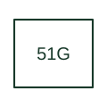

# Time ground-overcurrent protection

Supervises ground-current overcurrent with the timing defined by the selected relay and scheme.

[Canonical reference](https://eloragrid.ai/protection-functions/51g-time-ground-overcurrent-protection) · [Structured record](../entries/51g-time-ground-overcurrent-protection.json) · [All references](README.md)

Updated: 2026-10-27. Drawing use: SLD, Schematic. Reference families: IEEE / ANSI, Manufacturer.

## What it represents

Supervises ground-current overcurrent with the timing defined by the selected relay and scheme.
The drafting record should connect this function to the ground-current measurement input and grounding arrangement, then trace the timed earth-fault output and breaker trip path. Keep the complete designation and equipment tag together so that the SLD, relay logic and terminal schedule describe the same implementation.
The cited mapping is a public manufacturer example (SEL generator protection feature table). Suffixes are not universal equivalences across products, and this reference supplies neither a protection setting nor certification of the selected scheme.

## How to read it

- Identify the ground-current measurement input and grounding arrangement.
- Trace the timed earth-fault output and breaker trip path.

## Drawing checklist

- Label the ground-current measurement input and grounding arrangement.
- Cross-reference the timed earth-fault output and breaker trip path.
- Retain the complete suffix, selected device tag and manufacturer manual revision.

## Important distinction

Ground-current 51G and neutral-current 51N labels can reflect different inputs; do not merge them without the equipment documentation.

## Facts

- Function designation: 51G
- Base function: 51 — Time overcurrent
- Published mapping: SEL generator protection feature table
- Suffix scope: Application or manufacturer specific; check the complete drawing legend and selected device manual.

## Public references

- [Generator protection feature and function comparison](https://selinc.com/products/comparisons/generator-protection/) — Schweitzer Engineering Laboratories. Public primary-source function or application mapping used to identify this designation; wording and drafting notes are original.
- [IEEE C37.2-2022: power-system device function numbers](https://ieeexplore.ieee.org/document/9984140) — IEEE. Device-number and suffix convention. This page is not a reproduction of the full licensed standard.

## Related references

- [Time overcurrent](51-time-overcurrent.md)
- [Current transformer](current-transformer.md)

Original educational concept geometry, CC BY 4.0. Unitless; not a certified standards glyph or manufacturer footprint.

Elora-authored explanations are CC BY 4.0. Linked standards and manufacturer material retain their own rights. Confirm project requirements using primary sources.
