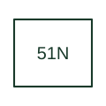

# Time neutral-overcurrent protection

Supervises neutral or residual overcurrent with the configured timing characteristic.

[Canonical reference](https://eloragrid.ai/protection-functions/51n-time-neutral-overcurrent-protection) · [Structured record](../entries/51n-time-neutral-overcurrent-protection.json) · [All references](README.md)

Updated: 2026-10-27. Drawing use: SLD, Schematic. Reference families: IEEE / ANSI, Manufacturer.

## What it represents

Supervises neutral or residual overcurrent with the configured timing characteristic.
The drafting record should connect this function to the neutral or residual measurement source and CT reference, then trace the neutral time-overcurrent output and earth-fault coordination reference. Keep the complete designation and equipment tag together so that the SLD, relay logic and terminal schedule describe the same implementation.
The cited mapping is a public manufacturer example (SEL public device-number table). Suffixes are not universal equivalences across products, and this reference supplies neither a protection setting nor certification of the selected scheme.

## How to read it

- Identify the neutral or residual measurement source and CT reference.
- Trace the neutral time-overcurrent output and earth-fault coordination reference.

## Drawing checklist

- Label the neutral or residual measurement source and CT reference.
- Cross-reference the neutral time-overcurrent output and earth-fault coordination reference.
- Retain the complete suffix, selected device tag and manufacturer manual revision.

## Important distinction

Neutral/residual 51N does not determine whether the source is a neutral CT or a residual sum; show the source explicitly.

## Facts

- Function designation: 51N
- Base function: 51 — Time overcurrent
- Published mapping: SEL public device-number table
- Suffix scope: Application or manufacturer specific; check the complete drawing legend and selected device manual.

## Public references

- [ANSI device-number and suffix reference table](https://selinc.com/pt/products/tables/ansi/) — Schweitzer Engineering Laboratories. Public primary-source function or application mapping used to identify this designation; wording and drafting notes are original.
- [IEEE C37.2-2022: power-system device function numbers](https://ieeexplore.ieee.org/document/9984140) — IEEE. Device-number and suffix convention. This page is not a reproduction of the full licensed standard.

## Related references

- [Time overcurrent](51-time-overcurrent.md)
- [Current transformer](current-transformer.md)

Original educational concept geometry, CC BY 4.0. Unitless; not a certified standards glyph or manufacturer footprint.

Elora-authored explanations are CC BY 4.0. Linked standards and manufacturer material retain their own rights. Confirm project requirements using primary sources.
