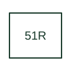

# Calculated residual time-overcurrent

Applies time-overcurrent protection to the calculated residual-current input in the cited Eaton family.

[Canonical reference](https://eloragrid.ai/protection-functions/51r-calculated-residual-time-overcurrent) · [Structured record](../entries/51r-calculated-residual-time-overcurrent.json) · [All references](README.md)

Updated: 2026-10-27. Drawing use: SLD, Schematic. Reference families: IEEE / ANSI, Manufacturer.

## What it represents

Applies time-overcurrent protection to the calculated residual-current input in the cited Eaton family.
The drafting record should connect this function to the phase CT inputs and calculated residual-current channel, then trace the residual time-current element and earth-fault trip. Keep the complete designation and equipment tag together so that the SLD, relay logic and terminal schedule describe the same implementation.
The cited mapping is a public manufacturer example (Eaton ETR family). Suffixes are not universal equivalences across products, and this reference supplies neither a protection setting nor certification of the selected scheme.

## How to read it

- Identify the phase CT inputs and calculated residual-current channel.
- Trace the residual time-current element and earth-fault trip.

## Drawing checklist

- Label the phase CT inputs and calculated residual-current channel.
- Cross-reference the residual time-current element and earth-fault trip.
- Retain the complete suffix, selected device tag and manufacturer manual revision.

## Important distinction

Eaton's 51R uses a calculated quantity; 51X uses a separately measured ground or neutral input.

## Facts

- Function designation: 51R
- Base function: 51 — Time overcurrent
- Published mapping: Eaton ETR family
- Suffix scope: Application or manufacturer specific; check the complete drawing legend and selected device manual.

## Public references

- [ETR-4000 and ETR-5000 transformer protection function tables](https://www.eaton.com/us/en-us/catalog/electrical-circuit-protection/transformer-relays.html) — Eaton. Public primary-source function or application mapping used to identify this designation; wording and drafting notes are original.
- [IEEE C37.2-2022: power-system device function numbers](https://ieeexplore.ieee.org/document/9984140) — IEEE. Device-number and suffix convention. This page is not a reproduction of the full licensed standard.

## Related references

- [Time overcurrent](51-time-overcurrent.md)
- [Current transformer](current-transformer.md)

Original educational concept geometry, CC BY 4.0. Unitless; not a certified standards glyph or manufacturer footprint.

Elora-authored explanations are CC BY 4.0. Linked standards and manufacturer material retain their own rights. Confirm project requirements using primary sources.
