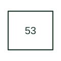

# Exciter or DC generator relay

Supervises an exciter or DC generator condition in a machine control arrangement.

[Canonical reference](https://eloragrid.ai/protection-functions/53-exciter-or-dc-generator-relay) · [Structured record](../entries/53-exciter-or-dc-generator-relay.json) · [All references](README.md)

Updated: 2026-10-27. Drawing use: SLD, Schematic. Reference families: IEEE / ANSI.

## What it represents

Supervises an exciter or DC generator condition in a machine control arrangement.
In a drafting package, connect this reference to the exciter or DC generator measurement connections. The associated drawing should trace the excitation-control sequence and protection outputs; the number identifies the role and does not specify the terminal arrangement, ratings or operating settings.
This designation is useful when reading machine and legacy control drawings. Retain the documented function on an existing drawing and consult the original equipment manual before assigning it to a new design.

## How to read it

- Identify the exciter or DC generator measurement connections.
- Trace the excitation-control sequence and protection outputs.

## Drawing checklist

- Label the exciter or DC generator measurement connections.
- Cross-reference the excitation-control sequence and protection outputs.
- Identify the device tag, manual revision and logic drawing that define this implementation.

## Important distinction

This specialist reference does not itself identify which voltage, current or build-up condition the selected relay checks.

## Facts

- ANSI / IEEE function number: 53
- Drawing context: The exciter or DC generator measurement connections
- Application scope: Specialist or legacy machine-control use; interpret with the equipment legend.

## Public references

- [ANSI device-number and suffix reference table](https://selinc.com/pt/products/tables/ansi/) — Schweitzer Engineering Laboratories. Public manufacturer number/name association. Drafting explanations are independently written.
- [IEEE C37.2-2022: power-system device function numbers](https://ieeexplore.ieee.org/document/9984140) — IEEE. Normative device-number publication; exact edition wording and compliance require the licensed standard.

## Related references

- [Generator](generator.md)
- [AC circuit breaker](52-ac-circuit-breaker.md)

Original educational concept geometry, CC BY 4.0. Unitless; not a certified standards glyph or manufacturer footprint.

Elora-authored explanations are CC BY 4.0. Linked standards and manufacturer material retain their own rights. Confirm project requirements using primary sources.
