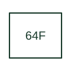

# Field ground-fault protection

Detects an earth fault in a machine field circuit using the selected field-ground detection arrangement.

[Canonical reference](https://eloragrid.ai/protection-functions/64f-field-ground-fault-protection) · [Structured record](../entries/64f-field-ground-fault-protection.json) · [All references](README.md)

Updated: 2026-10-27. Drawing use: SLD, Schematic. Reference families: IEEE / ANSI, Manufacturer.

## What it represents

Detects an earth fault in a machine field circuit using the selected field-ground detection arrangement.
The drafting record should connect this function to the field circuit, injection or sensing equipment and earth reference, then trace the field-ground alarm or trip output. Keep the complete designation and equipment tag together so that the SLD, relay logic and terminal schedule describe the same implementation.
The cited mapping is a public manufacturer example (SEL generator protection feature table). Suffixes are not universal equivalences across products, and this reference supplies neither a protection setting nor certification of the selected scheme.

## How to read it

- Identify the field circuit, injection or sensing equipment and earth reference.
- Trace the field-ground alarm or trip output.

## Drawing checklist

- Label the field circuit, injection or sensing equipment and earth reference.
- Cross-reference the field-ground alarm or trip output.
- Retain the complete suffix, selected device tag and manufacturer manual revision.

## Important distinction

Field-ground protection addresses the rotor excitation circuit; stator-ground function 64G addresses a different insulation system.

## Facts

- Function designation: 64F
- Base function: 64 — Ground detector protection
- Published mapping: SEL generator protection feature table
- Suffix scope: Application or manufacturer specific; check the complete drawing legend and selected device manual.

## Public references

- [Generator protection feature and function comparison](https://selinc.com/products/comparisons/generator-protection/) — Schweitzer Engineering Laboratories. Public primary-source function or application mapping used to identify this designation; wording and drafting notes are original.
- [IEEE C37.2-2022: power-system device function numbers](https://ieeexplore.ieee.org/document/9984140) — IEEE. Device-number and suffix convention. This page is not a reproduction of the full licensed standard.

## Related references

- [Ground detector protection](64-ground-detector-protection.md)
- [Current transformer](current-transformer.md)

Original educational concept geometry, CC BY 4.0. Unitless; not a certified standards glyph or manufacturer footprint.

Elora-authored explanations are CC BY 4.0. Linked standards and manufacturer material retain their own rights. Confirm project requirements using primary sources.
