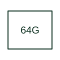

# Stator ground-fault protection

Supervises generator stator earth faults using the selected stator-ground protection method.

[Canonical reference](https://eloragrid.ai/protection-functions/64g-stator-ground-fault-protection) · [Structured record](../entries/64g-stator-ground-fault-protection.json) · [All references](README.md)

Updated: 2026-10-27. Drawing use: SLD, Schematic. Reference families: IEEE / ANSI, Manufacturer.

## What it represents

Supervises generator stator earth faults using the selected stator-ground protection method.
The drafting record should connect this function to the generator neutral arrangement and the voltage/current or injection inputs, then trace the stator-ground alarm and generator trip matrix. Keep the complete designation and equipment tag together so that the SLD, relay logic and terminal schedule describe the same implementation.
The cited mapping is a public manufacturer example (SEL generator protection feature table). Suffixes are not universal equivalences across products, and this reference supplies neither a protection setting nor certification of the selected scheme.

## How to read it

- Identify the generator neutral arrangement and the voltage/current or injection inputs.
- Trace the stator-ground alarm and generator trip matrix.

## Drawing checklist

- Label the generator neutral arrangement and the voltage/current or injection inputs.
- Cross-reference the stator-ground alarm and generator trip matrix.
- Retain the complete suffix, selected device tag and manufacturer manual revision.

## Important distinction

The number 64G alone does not establish 100-percent winding coverage; that depends on the actual method and equipment configuration.

## Facts

- Function designation: 64G
- Base function: 64 — Ground detector protection
- Published mapping: SEL generator protection feature table
- Suffix scope: Application or manufacturer specific; check the complete drawing legend and selected device manual.

## Public references

- [Generator protection feature and function comparison](https://selinc.com/products/comparisons/generator-protection/) — Schweitzer Engineering Laboratories. Public primary-source function or application mapping used to identify this designation; wording and drafting notes are original.
- [IEEE C37.2-2022: power-system device function numbers](https://ieeexplore.ieee.org/document/9984140) — IEEE. Device-number and suffix convention. This page is not a reproduction of the full licensed standard.

## Related references

- [Ground detector protection](64-ground-detector-protection.md)
- [Current transformer](current-transformer.md)

Original educational concept geometry, CC BY 4.0. Unitless; not a certified standards glyph or manufacturer footprint.

Elora-authored explanations are CC BY 4.0. Linked standards and manufacturer material retain their own rights. Confirm project requirements using primary sources.
