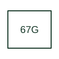

# Directional ground-overcurrent

Supervises a ground-current quantity with direction determined by the selected relay's polarising method.

[Canonical reference](https://eloragrid.ai/protection-functions/67g-directional-ground-overcurrent) · [Structured record](../entries/67g-directional-ground-overcurrent.json) · [All references](README.md)

Updated: 2026-10-27. Drawing use: SLD, Schematic. Reference families: IEEE / ANSI, Manufacturer.

## What it represents

Supervises a ground-current quantity with direction determined by the selected relay's polarising method.
The drafting record should connect this function to the ground-current input and voltage/current polarising references, then trace the ground directional element and breaker trip. Keep the complete designation and equipment tag together so that the SLD, relay logic and terminal schedule describe the same implementation.
The cited mapping is a public manufacturer example (SEL generator protection feature table). Suffixes are not universal equivalences across products, and this reference supplies neither a protection setting nor certification of the selected scheme.

## How to read it

- Identify the ground-current input and voltage/current polarising references.
- Trace the ground directional element and breaker trip.

## Drawing checklist

- Label the ground-current input and voltage/current polarising references.
- Cross-reference the ground directional element and breaker trip.
- Retain the complete suffix, selected device tag and manufacturer manual revision.

## Important distinction

Ground and neutral suffixes may identify different inputs; the selected relay's mapping decides how G differs from N.

## Facts

- Function designation: 67G
- Base function: 67 — Directional overcurrent
- Published mapping: SEL generator protection feature table
- Suffix scope: Application or manufacturer specific; check the complete drawing legend and selected device manual.

## Public references

- [Generator protection feature and function comparison](https://selinc.com/products/comparisons/generator-protection/) — Schweitzer Engineering Laboratories. Public primary-source function or application mapping used to identify this designation; wording and drafting notes are original.
- [IEEE C37.2-2022: power-system device function numbers](https://ieeexplore.ieee.org/document/9984140) — IEEE. Device-number and suffix convention. This page is not a reproduction of the full licensed standard.

## Related references

- [Directional overcurrent](67-directional-overcurrent.md)
- [Current transformer](current-transformer.md)

Original educational concept geometry, CC BY 4.0. Unitless; not a certified standards glyph or manufacturer footprint.

Elora-authored explanations are CC BY 4.0. Linked standards and manufacturer material retain their own rights. Confirm project requirements using primary sources.
