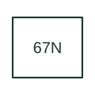

# Directional neutral-overcurrent

Supervises neutral or residual overcurrent with a documented directional criterion.

[Canonical reference](https://eloragrid.ai/protection-functions/67n-directional-neutral-overcurrent) · [Structured record](../entries/67n-directional-neutral-overcurrent.json) · [All references](README.md)

Updated: 2026-10-27. Drawing use: SLD, Schematic. Reference families: IEEE / ANSI, Manufacturer.

## What it represents

Supervises neutral or residual overcurrent with a documented directional criterion.
The drafting record should connect this function to the residual/neutral CT source and the selected polarising quantity, then trace the directional earth-fault element and feeder trip path. Keep the complete designation and equipment tag together so that the SLD, relay logic and terminal schedule describe the same implementation.
The cited mapping is a public manufacturer example (SEL public device-number table). Suffixes are not universal equivalences across products, and this reference supplies neither a protection setting nor certification of the selected scheme.

## How to read it

- Identify the residual/neutral CT source and the selected polarising quantity.
- Trace the directional earth-fault element and feeder trip path.

## Drawing checklist

- Label the residual/neutral CT source and the selected polarising quantity.
- Cross-reference the directional earth-fault element and feeder trip path.
- Retain the complete suffix, selected device tag and manufacturer manual revision.

## Important distinction

67N requires both a current criterion and direction information; a neutral current magnitude alone does not provide direction.

## Facts

- Function designation: 67N
- Base function: 67 — Directional overcurrent
- Published mapping: SEL public device-number table
- Suffix scope: Application or manufacturer specific; check the complete drawing legend and selected device manual.

## Public references

- [ANSI device-number and suffix reference table](https://selinc.com/pt/products/tables/ansi/) — Schweitzer Engineering Laboratories. Public primary-source function or application mapping used to identify this designation; wording and drafting notes are original.
- [IEEE C37.2-2022: power-system device function numbers](https://ieeexplore.ieee.org/document/9984140) — IEEE. Device-number and suffix convention. This page is not a reproduction of the full licensed standard.

## Related references

- [Directional overcurrent](67-directional-overcurrent.md)
- [Current transformer](current-transformer.md)

Original educational concept geometry, CC BY 4.0. Unitless; not a certified standards glyph or manufacturer footprint.

Elora-authored explanations are CC BY 4.0. Linked standards and manufacturer material retain their own rights. Confirm project requirements using primary sources.
