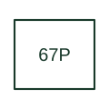

# Directional phase-overcurrent

Combines phase-current overcurrent operation with the scheme's direction criterion.

[Canonical reference](https://eloragrid.ai/protection-functions/67p-directional-phase-overcurrent) · [Structured record](../entries/67p-directional-phase-overcurrent.json) · [All references](README.md)

Updated: 2026-10-27. Drawing use: SLD, Schematic. Reference families: IEEE / ANSI, Manufacturer.

## What it represents

Combines phase-current overcurrent operation with the scheme's direction criterion.
The drafting record should connect this function to the phase CT and polarising voltage references and forward-direction definition, then trace the directional phase trip and any pilot-scheme interface. Keep the complete designation and equipment tag together so that the SLD, relay logic and terminal schedule describe the same implementation.
The cited mapping is a public manufacturer example (Eaton E-Series function mapping). Suffixes are not universal equivalences across products, and this reference supplies neither a protection setting nor certification of the selected scheme.

## How to read it

- Identify the phase CT and polarising voltage references and forward-direction definition.
- Trace the directional phase trip and any pilot-scheme interface.

## Drawing checklist

- Label the phase CT and polarising voltage references and forward-direction definition.
- Cross-reference the directional phase trip and any pilot-scheme interface.
- Retain the complete suffix, selected device tag and manufacturer manual revision.

## Important distinction

Directional phase overcurrent 67P supervises phase quantities; neutral and ground variants use their specified residual or ground inputs.

## Facts

- Function designation: 67P
- Base function: 67 — Directional overcurrent
- Published mapping: Eaton E-Series function mapping
- Suffix scope: Application or manufacturer specific; check the complete drawing legend and selected device manual.

## Public references

- [E-Series protective relays: public family comparison brochure](https://www.eaton.com/content/dam/eaton/products/electrical-circuit-protection/protective-relays-and-predictive-devices/e-series-protective-relays-br026001en.pdf) — Eaton. Public primary-source function or application mapping used to identify this designation; wording and drafting notes are original.
- [IEEE C37.2-2022: power-system device function numbers](https://ieeexplore.ieee.org/document/9984140) — IEEE. Device-number and suffix convention. This page is not a reproduction of the full licensed standard.

## Related references

- [Directional overcurrent](67-directional-overcurrent.md)
- [Current transformer](current-transformer.md)

Original educational concept geometry, CC BY 4.0. Unitless; not a certified standards glyph or manufacturer footprint.

Elora-authored explanations are CC BY 4.0. Linked standards and manufacturer material retain their own rights. Confirm project requirements using primary sources.
