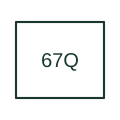

# Directional negative-sequence overcurrent

Uses negative-sequence quantities to supervise overcurrent operation in a defined direction.

[Canonical reference](https://eloragrid.ai/protection-functions/67q-directional-negative-sequence-overcurrent) · [Structured record](../entries/67q-directional-negative-sequence-overcurrent.json) · [All references](README.md)

Updated: 2026-10-27. Drawing use: SLD, Schematic. Reference families: IEEE / ANSI, Manufacturer.

## What it represents

Uses negative-sequence quantities to supervise overcurrent operation in a defined direction.
The drafting record should connect this function to the three phase CT/VT inputs and negative-sequence polarising convention, then trace the directional negative-sequence trip or scheme permission. Keep the complete designation and equipment tag together so that the SLD, relay logic and terminal schedule describe the same implementation.
The cited mapping is a public manufacturer example (SEL generator protection feature table). Suffixes are not universal equivalences across products, and this reference supplies neither a protection setting nor certification of the selected scheme.

## How to read it

- Identify the three phase CT/VT inputs and negative-sequence polarising convention.
- Trace the directional negative-sequence trip or scheme permission.

## Drawing checklist

- Label the three phase CT/VT inputs and negative-sequence polarising convention.
- Cross-reference the directional negative-sequence trip or scheme permission.
- Retain the complete suffix, selected device tag and manufacturer manual revision.

## Important distinction

67Q is a sequence-based directional element, not a physical negative-sequence CT connection.

## Facts

- Function designation: 67Q
- Base function: 67 — Directional overcurrent
- Published mapping: SEL generator protection feature table
- Suffix scope: Application or manufacturer specific; check the complete drawing legend and selected device manual.

## Public references

- [Generator protection feature and function comparison](https://selinc.com/products/comparisons/generator-protection/) — Schweitzer Engineering Laboratories. Public primary-source function or application mapping used to identify this designation; wording and drafting notes are original.
- [IEEE C37.2-2022: power-system device function numbers](https://ieeexplore.ieee.org/document/9984140) — IEEE. Device-number and suffix convention. This page is not a reproduction of the full licensed standard.

## Related references

- [Directional overcurrent](67-directional-overcurrent.md)
- [Current transformer](current-transformer.md)

Original educational concept geometry, CC BY 4.0. Unitless; not a certified standards glyph or manufacturer footprint.

Elora-authored explanations are CC BY 4.0. Linked standards and manufacturer material retain their own rights. Confirm project requirements using primary sources.
