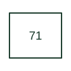

# Level switch or relay

Signals a defined level condition in the monitored equipment.

[Canonical reference](https://eloragrid.ai/protection-functions/71-level-switch-or-relay) · [Structured record](../entries/71-level-switch-or-relay.json) · [All references](README.md)

Updated: 2026-10-27. Drawing use: SLD, Schematic. Reference families: IEEE / ANSI.

## What it represents

Signals a defined level condition in the monitored equipment.
In a drafting package, connect this reference to the level sensor location and high/low contact meaning. The associated drawing should trace the level alarm, pump control or trip destination; the number identifies the role and does not specify the terminal arrangement, ratings or operating settings.

## How to read it

- Identify the level sensor location and high/low contact meaning.
- Trace the level alarm, pump control or trip destination.

## Drawing checklist

- Label the level sensor location and high/low contact meaning.
- Cross-reference the level alarm, pump control or trip destination.
- Identify the device tag, manual revision and logic drawing that define this implementation.

## Important distinction

A level switch supervises level; flow switch 80 supervises movement through a circuit.

## Facts

- ANSI / IEEE function number: 71
- Drawing context: The level sensor location and high/low contact meaning
- Application scope: Protection or apparatus-control role; exact implementation is defined by the equipment documentation.

## Public references

- [ANSI device-number and suffix reference table](https://selinc.com/pt/products/tables/ansi/) — Schweitzer Engineering Laboratories. Public manufacturer number/name association. Drafting explanations are independently written.
- [IEEE C37.2-2022: power-system device function numbers](https://ieeexplore.ieee.org/document/9984140) — IEEE. Normative device-number publication; exact edition wording and compliance require the licensed standard.

## Related references

- [Transformer envelope](transformer-envelope.md)
- [AC circuit breaker](52-ac-circuit-breaker.md)

Original educational concept geometry, CC BY 4.0. Unitless; not a certified standards glyph or manufacturer footprint.

Elora-authored explanations are CC BY 4.0. Linked standards and manufacturer material retain their own rights. Confirm project requirements using primary sources.
