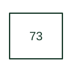

# Load-resistor contactor

Switches a resistor used to impose, remove or change electrical load in a machine arrangement.

[Canonical reference](https://eloragrid.ai/protection-functions/73-load-resistor-contactor) · [Structured record](../entries/73-load-resistor-contactor.json) · [All references](README.md)

Updated: 2026-10-27. Drawing use: SLD, Schematic. Reference families: IEEE / ANSI.

## What it represents

Switches a resistor used to impose, remove or change electrical load in a machine arrangement.
In a drafting package, connect this reference to the load resistor and switched power connection. The associated drawing should trace the contactor control and resistor duty references; the number identifies the role and does not specify the terminal arrangement, ratings or operating settings.
This designation is useful when reading machine and legacy control drawings. Retain the documented function on an existing drawing and consult the original equipment manual before assigning it to a new design.

## How to read it

- Identify the load resistor and switched power connection.
- Trace the contactor control and resistor duty references.

## Drawing checklist

- Label the load resistor and switched power connection.
- Cross-reference the contactor control and resistor duty references.
- Identify the device tag, manual revision and logic drawing that define this implementation.

## Important distinction

A load-resistor contactor switches the resistor circuit; the resistor's rating and ventilation remain separate design data.

## Facts

- ANSI / IEEE function number: 73
- Drawing context: The load resistor and switched power connection
- Application scope: Specialist or legacy machine-control use; interpret with the equipment legend.

## Public references

- [ANSI device-number and suffix reference table](https://selinc.com/pt/products/tables/ansi/) — Schweitzer Engineering Laboratories. Public manufacturer number/name association. Drafting explanations are independently written.
- [IEEE C37.2-2022: power-system device function numbers](https://ieeexplore.ieee.org/document/9984140) — IEEE. Normative device-number publication; exact edition wording and compliance require the licensed standard.

## Related references

- [Resistor](resistor.md)
- [AC circuit breaker](52-ac-circuit-breaker.md)

Original educational concept geometry, CC BY 4.0. Unitless; not a certified standards glyph or manufacturer footprint.

Elora-authored explanations are CC BY 4.0. Linked standards and manufacturer material retain their own rights. Confirm project requirements using primary sources.
