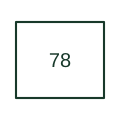

# Phase-angle or out-of-step protection

Supervises the angular relationship or loss of synchronism of an electrical system or machine.

[Canonical reference](https://eloragrid.ai/protection-functions/78-phase-angle-or-out-of-step-protection) · [Structured record](../entries/78-phase-angle-or-out-of-step-protection.json) · [All references](README.md)

Updated: 2026-10-27. Drawing use: SLD, Schematic. Reference families: IEEE / ANSI.

## What it represents

Supervises the angular relationship or loss of synchronism of an electrical system or machine.
In a drafting package, connect this reference to the voltage/current measurement references and protected machine. The associated drawing should trace the out-of-step trip, separation or blocking outputs; the number identifies the role and does not specify the terminal arrangement, ratings or operating settings.

## How to read it

- Identify the voltage/current measurement references and protected machine.
- Trace the out-of-step trip, separation or blocking outputs.

## Drawing checklist

- Label the voltage/current measurement references and protected machine.
- Cross-reference the out-of-step trip, separation or blocking outputs.
- Identify the device tag, manual revision and logic drawing that define this implementation.

## Important distinction

Out-of-step protection during operation is distinct from a 25 closing-permission synchronism check.

## Facts

- ANSI / IEEE function number: 78
- Drawing context: The voltage/current measurement references and protected machine
- Application scope: Protection or apparatus-control role; exact implementation is defined by the equipment documentation.

## Public references

- [ANSI device-number and suffix reference table](https://selinc.com/pt/products/tables/ansi/) — Schweitzer Engineering Laboratories. Public manufacturer number/name association. Drafting explanations are independently written.
- [IEEE C37.2-2022: power-system device function numbers](https://ieeexplore.ieee.org/document/9984140) — IEEE. Normative device-number publication; exact edition wording and compliance require the licensed standard.

## Related references

- [Generator](generator.md)
- [AC circuit breaker](52-ac-circuit-breaker.md)

Original educational concept geometry, CC BY 4.0. Unitless; not a certified standards glyph or manufacturer footprint.

Elora-authored explanations are CC BY 4.0. Linked standards and manufacturer material retain their own rights. Confirm project requirements using primary sources.
