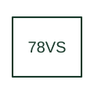

# Voltage vector-shift protection

Supervises an abrupt change in the measured voltage phase angle using the selected relay's vector-shift method.

[Canonical reference](https://eloragrid.ai/protection-functions/78vs-voltage-vector-shift-protection) · [Structured record](../entries/78vs-voltage-vector-shift-protection.json) · [All references](README.md)

Updated: 2026-10-27. Drawing use: SLD, Schematic. Reference families: IEEE / ANSI, Manufacturer.

## What it represents

Supervises an abrupt change in the measured voltage phase angle using the selected relay's vector-shift method.
The drafting record should connect this function to the measured voltage inputs and interconnection point, then trace the vector-shift operating output and interconnection protection logic. Keep the complete designation and equipment tag together so that the SLD, relay logic and terminal schedule describe the same implementation.
The cited mapping is a public manufacturer example (SEL generator protection feature table). Suffixes are not universal equivalences across products, and this reference supplies neither a protection setting nor certification of the selected scheme.

## How to read it

- Identify the measured voltage inputs and interconnection point.
- Trace the vector-shift operating output and interconnection protection logic.

## Drawing checklist

- Label the measured voltage inputs and interconnection point.
- Cross-reference the vector-shift operating output and interconnection protection logic.
- Retain the complete suffix, selected device tag and manufacturer manual revision.

## Important distinction

Vector shift 78VS/78V is a product-mapped function and differs from the complete out-of-step or pole-slip application of base 78.

## Facts

- Function designation: 78VS
- Base function: 78 — Phase-angle or out-of-step protection
- Published mapping: SEL generator protection feature table
- Suffix scope: Application or manufacturer specific; check the complete drawing legend and selected device manual.

## Public references

- [Generator protection feature and function comparison](https://selinc.com/products/comparisons/generator-protection/) — Schweitzer Engineering Laboratories. Public primary-source function or application mapping used to identify this designation; wording and drafting notes are original.
- [IEEE C37.2-2022: power-system device function numbers](https://ieeexplore.ieee.org/document/9984140) — IEEE. Device-number and suffix convention. This page is not a reproduction of the full licensed standard.

## Related references

- [Phase-angle or out-of-step protection](78-phase-angle-or-out-of-step-protection.md)
- [Voltage transformer](voltage-transformer.md)

Original educational concept geometry, CC BY 4.0. Unitless; not a certified standards glyph or manufacturer footprint.

Elora-authored explanations are CC BY 4.0. Linked standards and manufacturer material retain their own rights. Confirm project requirements using primary sources.
