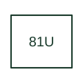

# Underfrequency protection

Supervises frequency below the defined operating criterion.

[Canonical reference](https://eloragrid.ai/protection-functions/81u-underfrequency-protection) · [Structured record](../entries/81u-underfrequency-protection.json) · [All references](README.md)

Updated: 2026-10-27. Drawing use: SLD, Schematic. Reference families: IEEE / ANSI, Manufacturer.

## What it represents

Supervises frequency below the defined operating criterion.
The drafting record should connect this function to the voltage-derived frequency source and minimum-voltage supervision, then trace the underfrequency trip or staged load-shedding output. Keep the complete designation and equipment tag together so that the SLD, relay logic and terminal schedule describe the same implementation.
The cited mapping is a public manufacturer example (Eaton E-Series function mapping). Suffixes are not universal equivalences across products, and this reference supplies neither a protection setting nor certification of the selected scheme.

## How to read it

- Identify the voltage-derived frequency source and minimum-voltage supervision.
- Trace the underfrequency trip or staged load-shedding output.

## Drawing checklist

- Label the voltage-derived frequency source and minimum-voltage supervision.
- Cross-reference the underfrequency trip or staged load-shedding output.
- Retain the complete suffix, selected device tag and manufacturer manual revision.

## Important distinction

Underfrequency measures frequency magnitude; rate-of-change function 81R evaluates its change over time.

## Facts

- Function designation: 81U
- Base function: 81 — Frequency protection
- Published mapping: Eaton E-Series function mapping
- Suffix scope: Application or manufacturer specific; check the complete drawing legend and selected device manual.

## Public references

- [E-Series protective relays: public family comparison brochure](https://www.eaton.com/content/dam/eaton/products/electrical-circuit-protection/protective-relays-and-predictive-devices/e-series-protective-relays-br026001en.pdf) — Eaton. Public primary-source function or application mapping used to identify this designation; wording and drafting notes are original.
- [IEEE C37.2-2022: power-system device function numbers](https://ieeexplore.ieee.org/document/9984140) — IEEE. Device-number and suffix convention. This page is not a reproduction of the full licensed standard.

## Related references

- [Frequency protection](81-frequency.md)
- [Voltage transformer](voltage-transformer.md)

Original educational concept geometry, CC BY 4.0. Unitless; not a certified standards glyph or manufacturer footprint.

Elora-authored explanations are CC BY 4.0. Linked standards and manufacturer material retain their own rights. Confirm project requirements using primary sources.
