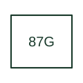

# Generator differential protection

Compares current measurements bounding the selected generator differential zone.

[Canonical reference](https://eloragrid.ai/protection-functions/87g-generator-differential-protection) · [Structured record](../entries/87g-generator-differential-protection.json) · [All references](README.md)

Updated: 2026-10-27. Drawing use: SLD, Schematic. Reference families: IEEE / ANSI, Manufacturer.

## What it represents

Compares current measurements bounding the selected generator differential zone.
The drafting record should connect this function to the generator terminal and neutral-side CT connections, then trace the generator differential zone and unit tripping matrix. Keep the complete designation and equipment tag together so that the SLD, relay logic and terminal schedule describe the same implementation.
The cited mapping is a public manufacturer example (SEL public device-number table). Suffixes are not universal equivalences across products, and this reference supplies neither a protection setting nor certification of the selected scheme.

## How to read it

- Identify the generator terminal and neutral-side CT connections.
- Trace the generator differential zone and unit tripping matrix.

## Drawing checklist

- Label the generator terminal and neutral-side CT connections.
- Cross-reference the generator differential zone and unit tripping matrix.
- Retain the complete suffix, selected device tag and manufacturer manual revision.

## Important distinction

G denotes generator in this differential application; it should not be interpreted using the ground-current meaning of 50G.

## Facts

- Function designation: 87G
- Base function: 87 — Differential protection
- Published mapping: SEL public device-number table
- Suffix scope: Application or manufacturer specific; check the complete drawing legend and selected device manual.

## Public references

- [ANSI device-number and suffix reference table](https://selinc.com/pt/products/tables/ansi/) — Schweitzer Engineering Laboratories. Public primary-source function or application mapping used to identify this designation; wording and drafting notes are original.
- [IEEE C37.2-2022: power-system device function numbers](https://ieeexplore.ieee.org/document/9984140) — IEEE. Device-number and suffix convention. This page is not a reproduction of the full licensed standard.

## Related references

- [Differential protection](87-differential.md)
- [Current transformer](current-transformer.md)

Original educational concept geometry, CC BY 4.0. Unitless; not a certified standards glyph or manufacturer footprint.

Elora-authored explanations are CC BY 4.0. Linked standards and manufacturer material retain their own rights. Confirm project requirements using primary sources.
