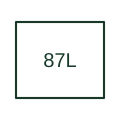

# Line current differential protection

Compares current information from the terminals of a protected line using a communication-assisted differential scheme.

[Canonical reference](https://eloragrid.ai/protection-functions/87l-line-current-differential-protection) · [Structured record](../entries/87l-line-current-differential-protection.json) · [All references](README.md)

Updated: 2026-10-27. Drawing use: SLD, Schematic. Reference families: IEEE / ANSI, Manufacturer.

## What it represents

Compares current information from the terminals of a protected line using a communication-assisted differential scheme.
The drafting record should connect this function to the local and remote terminal CTs and protection communication links, then trace the line differential zone and terminal breaker trips. Keep the complete designation and equipment tag together so that the SLD, relay logic and terminal schedule describe the same implementation.
The cited mapping is a public manufacturer example (SEL line differential documentation). Suffixes are not universal equivalences across products, and this reference supplies neither a protection setting nor certification of the selected scheme.

## How to read it

- Identify the local and remote terminal CTs and protection communication links.
- Trace the line differential zone and terminal breaker trips.

## Drawing checklist

- Label the local and remote terminal CTs and protection communication links.
- Cross-reference the line differential zone and terminal breaker trips.
- Retain the complete suffix, selected device tag and manufacturer manual revision.

## Important distinction

Line differential requires its measurement and communication arrangement; it is not a local distance zone or directional permissive alone.

## Facts

- Function designation: 87L
- Base function: 87 — Differential protection
- Published mapping: SEL line differential documentation
- Suffix scope: Application or manufacturer specific; check the complete drawing legend and selected device manual.

## Public references

- [SEL-411L line differential protection overview](https://selinc.com/products/411l/) — Schweitzer Engineering Laboratories. Public primary-source function or application mapping used to identify this designation; wording and drafting notes are original.
- [IEEE C37.2-2022: power-system device function numbers](https://ieeexplore.ieee.org/document/9984140) — IEEE. Device-number and suffix convention. This page is not a reproduction of the full licensed standard.

## Related references

- [Differential protection](87-differential.md)
- [Current transformer](current-transformer.md)

Original educational concept geometry, CC BY 4.0. Unitless; not a certified standards glyph or manufacturer footprint.

Elora-authored explanations are CC BY 4.0. Linked standards and manufacturer material retain their own rights. Confirm project requirements using primary sources.
