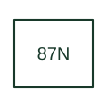

# Neutral differential protection

Identifies a differential scheme involving neutral or residual-current quantities as defined by the equipment documentation.

[Canonical reference](https://eloragrid.ai/protection-functions/87n-neutral-differential-protection) · [Structured record](../entries/87n-neutral-differential-protection.json) · [All references](README.md)

Updated: 2026-10-27. Drawing use: SLD, Schematic. Reference families: IEEE / ANSI, Manufacturer.

## What it represents

Identifies a differential scheme involving neutral or residual-current quantities as defined by the equipment documentation.
The drafting record should connect this function to the neutral and phase/residual CT circuits and protected winding boundary, then trace the neutral differential operating element and earth-fault trip matrix. Keep the complete designation and equipment tag together so that the SLD, relay logic and terminal schedule describe the same implementation.
The cited mapping is a public manufacturer example (SEL public device-number table). Suffixes are not universal equivalences across products, and this reference supplies neither a protection setting nor certification of the selected scheme.

## How to read it

- Identify the neutral and phase/residual CT circuits and protected winding boundary.
- Trace the neutral differential operating element and earth-fault trip matrix.

## Drawing checklist

- Label the neutral and phase/residual CT circuits and protected winding boundary.
- Cross-reference the neutral differential operating element and earth-fault trip matrix.
- Retain the complete suffix, selected device tag and manufacturer manual revision.

## Important distinction

The N suffix does not establish whether the scheme is high- or low-impedance restricted earth fault; record the actual scheme.

## Facts

- Function designation: 87N
- Base function: 87 — Differential protection
- Published mapping: SEL public device-number table
- Suffix scope: Application or manufacturer specific; check the complete drawing legend and selected device manual.

## Public references

- [ANSI device-number and suffix reference table](https://selinc.com/pt/products/tables/ansi/) — Schweitzer Engineering Laboratories. Public primary-source function or application mapping used to identify this designation; wording and drafting notes are original.
- [IEEE C37.2-2022: power-system device function numbers](https://ieeexplore.ieee.org/document/9984140) — IEEE. Device-number and suffix convention. This page is not a reproduction of the full licensed standard.

## Related references

- [Differential protection](87-differential.md)
- [Current transformer](current-transformer.md)

Original educational concept geometry, CC BY 4.0. Unitless; not a certified standards glyph or manufacturer footprint.

Elora-authored explanations are CC BY 4.0. Linked standards and manufacturer material retain their own rights. Confirm project requirements using primary sources.
