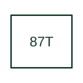

# Transformer differential protection

Compares currents associated with a transformer protection zone using the selected relay's differential method.

[Canonical reference](https://eloragrid.ai/protection-functions/87t-transformer-differential-protection) · [Structured record](../entries/87t-transformer-differential-protection.json) · [All references](README.md)

Updated: 2026-10-27. Drawing use: SLD, Schematic. Reference families: IEEE / ANSI, Manufacturer.

## What it represents

Compares currents associated with a transformer protection zone using the selected relay's differential method.
The drafting record should connect this function to the transformer winding CT circuits, polarity and ratio references, then trace the transformer differential zone and breaker trip matrix. Keep the complete designation and equipment tag together so that the SLD, relay logic and terminal schedule describe the same implementation.
The cited mapping is a public manufacturer example (ABB Relion 620 function mapping). Suffixes are not universal equivalences across products, and this reference supplies neither a protection setting nor certification of the selected scheme.

## How to read it

- Identify the transformer winding CT circuits, polarity and ratio references.
- Trace the transformer differential zone and breaker trip matrix.

## Drawing checklist

- Label the transformer winding CT circuits, polarity and ratio references.
- Cross-reference the transformer differential zone and breaker trip matrix.
- Retain the complete suffix, selected device tag and manufacturer manual revision.

## Important distinction

Transformer differential needs a defined zone and winding compensation; it differs from restricted earth-fault protection limited to one earthed winding.

## Facts

- Function designation: 87T
- Base function: 87 — Differential protection
- Published mapping: ABB Relion 620 function mapping
- Suffix scope: Application or manufacturer specific; check the complete drawing legend and selected device manual.

## Public references

- [Relion 620 series: published protection function and designation mappings](https://techdoc.relays.protection-control.abb/r/620-series-IEC-60870-5-103-Point-List-Manual/2.0-FP1-IEC/en-US/Functions-codes-and-symbols) — ABB. Public primary-source function or application mapping used to identify this designation; wording and drafting notes are original.
- [IEEE C37.2-2022: power-system device function numbers](https://ieeexplore.ieee.org/document/9984140) — IEEE. Device-number and suffix convention. This page is not a reproduction of the full licensed standard.

## Related references

- [Differential protection](87-differential.md)
- [Current transformer](current-transformer.md)

Original educational concept geometry, CC BY 4.0. Unitless; not a certified standards glyph or manufacturer footprint.

Elora-authored explanations are CC BY 4.0. Linked standards and manufacturer material retain their own rights. Confirm project requirements using primary sources.
