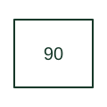

# Regulating device

Adjusts equipment to maintain the controlled electrical or operating quantity.

[Canonical reference](https://eloragrid.ai/protection-functions/90-regulating-device) · [Structured record](../entries/90-regulating-device.json) · [All references](README.md)

Updated: 2026-10-27. Drawing use: SLD, Schematic. Reference families: IEEE / ANSI.

## What it represents

Adjusts equipment to maintain the controlled electrical or operating quantity.
In a drafting package, connect this reference to the reference value, feedback measurement and control mode. The associated drawing should trace the regulating actuator, excitation or tap-changing interface; the number identifies the role and does not specify the terminal arrangement, ratings or operating settings.

## How to read it

- Identify the reference value, feedback measurement and control mode.
- Trace the regulating actuator, excitation or tap-changing interface.

## Drawing checklist

- Label the reference value, feedback measurement and control mode.
- Cross-reference the regulating actuator, excitation or tap-changing interface.
- Identify the device tag, manual revision and logic drawing that define this implementation.

## Important distinction

Device 90 is a general regulating role; identify whether this instance controls voltage, taps or another quantity.

## Facts

- ANSI / IEEE function number: 90
- Drawing context: The reference value, feedback measurement and control mode
- Application scope: Protection or apparatus-control role; exact implementation is defined by the equipment documentation.

## Public references

- [ANSI device-number and suffix reference table](https://selinc.com/pt/products/tables/ansi/) — Schweitzer Engineering Laboratories. Public manufacturer number/name association. Drafting explanations are independently written.
- [IEEE C37.2-2022: power-system device function numbers](https://ieeexplore.ieee.org/document/9984140) — IEEE. Normative device-number publication; exact edition wording and compliance require the licensed standard.

## Related references

- [Power transformer](power-transformer.md)
- [AC circuit breaker](52-ac-circuit-breaker.md)

Original educational concept geometry, CC BY 4.0. Unitless; not a certified standards glyph or manufacturer footprint.

Elora-authored explanations are CC BY 4.0. Linked standards and manufacturer material retain their own rights. Confirm project requirements using primary sources.
