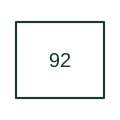

# Voltage and power directional relay

Combines voltage and power directional criteria in the specified control or protection arrangement.

[Canonical reference](https://eloragrid.ai/protection-functions/92-voltage-and-power-directional-relay) · [Structured record](../entries/92-voltage-and-power-directional-relay.json) · [All references](README.md)

Updated: 2026-10-27. Drawing use: SLD, Schematic. Reference families: IEEE / ANSI.

## What it represents

Combines voltage and power directional criteria in the specified control or protection arrangement.
In a drafting package, connect this reference to the voltage and current measurement references. The associated drawing should trace the permitted or blocked operating action; the number identifies the role and does not specify the terminal arrangement, ratings or operating settings.
This designation is useful when reading machine and legacy control drawings. Retain the documented function on an existing drawing and consult the original equipment manual before assigning it to a new design.

## How to read it

- Identify the voltage and current measurement references.
- Trace the permitted or blocked operating action.

## Drawing checklist

- Label the voltage and current measurement references.
- Cross-reference the permitted or blocked operating action.
- Identify the device tag, manual revision and logic drawing that define this implementation.

## Important distinction

This specialist combined reference requires a scheme description; it should not replace separate modern function labels without justification.

## Facts

- ANSI / IEEE function number: 92
- Drawing context: The voltage and current measurement references
- Application scope: Specialist or legacy machine-control use; interpret with the equipment legend.

## Public references

- [ANSI device-number and suffix reference table](https://selinc.com/pt/products/tables/ansi/) — Schweitzer Engineering Laboratories. Public manufacturer number/name association. Drafting explanations are independently written.
- [IEEE C37.2-2022: power-system device function numbers](https://ieeexplore.ieee.org/document/9984140) — IEEE. Normative device-number publication; exact edition wording and compliance require the licensed standard.

## Related references

- [Directional power](32-directional-power.md)
- [AC circuit breaker](52-ac-circuit-breaker.md)

Original educational concept geometry, CC BY 4.0. Unitless; not a certified standards glyph or manufacturer footprint.

Elora-authored explanations are CC BY 4.0. Linked standards and manufacturer material retain their own rights. Confirm project requirements using primary sources.
