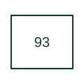

# Field-changing contactor

Changes the machine excitation connection or arrangement as part of a controlled field sequence.

[Canonical reference](https://eloragrid.ai/protection-functions/93-field-changing-contactor) · [Structured record](../entries/93-field-changing-contactor.json) · [All references](README.md)

Updated: 2026-10-27. Drawing use: SLD, Schematic. Reference families: IEEE / ANSI.

## What it represents

Changes the machine excitation connection or arrangement as part of a controlled field sequence.
In a drafting package, connect this reference to the field circuits and alternative excitation connections. The associated drawing should trace the field-change coil, contacts and interlocks; the number identifies the role and does not specify the terminal arrangement, ratings or operating settings.
This designation is useful when reading machine and legacy control drawings. Retain the documented function on an existing drawing and consult the original equipment manual before assigning it to a new design.

## How to read it

- Identify the field circuits and alternative excitation connections.
- Trace the field-change coil, contacts and interlocks.

## Drawing checklist

- Label the field circuits and alternative excitation connections.
- Cross-reference the field-change coil, contacts and interlocks.
- Identify the device tag, manual revision and logic drawing that define this implementation.

## Important distinction

Field-changing 93 switches an excitation arrangement; field application 56 initiates application of the field.

## Facts

- ANSI / IEEE function number: 93
- Drawing context: The field circuits and alternative excitation connections
- Application scope: Specialist or legacy machine-control use; interpret with the equipment legend.

## Public references

- [SecoGear medium-voltage switchgear application and technical guide, DET-882](https://library.e.abb.com/public/a06cf4cf38b34800b27bb337ab12f74f/DET-882%20SecoGear%205kV-15kV%20IEEE%20Metal%20Clad%20Switchgear_Application%20and%20installation%20guide.pdf) — ABB. Public manufacturer number/name association. Drafting explanations are independently written.
- [IEEE C37.2-2022: power-system device function numbers](https://ieeexplore.ieee.org/document/9984140) — IEEE. Normative device-number publication; exact edition wording and compliance require the licensed standard.

## Related references

- [Generator](generator.md)
- [AC circuit breaker](52-ac-circuit-breaker.md)

Original educational concept geometry, CC BY 4.0. Unitless; not a certified standards glyph or manufacturer footprint.

Elora-authored explanations are CC BY 4.0. Linked standards and manufacturer material retain their own rights. Confirm project requirements using primary sources.
