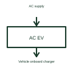

# AC electric vehicle charge point

An AC charge point controls the AC supply and charging interface presented to a vehicle.

[Canonical reference](https://eloragrid.ai/symbols/ac-ev-charge-point) · [Structured record](../entries/ac-ev-charge-point.json) · [All references](README.md)

Updated: 2026-10-27. Drawing use: Schematic. Reference families: Manufacturer.

## What it represents

An AC charge point controls the AC supply and charging interface presented to a vehicle.
The vehicle's onboard charger performs the conversion needed to charge its battery from an AC connection.
Draw the AC power path, controlled switching and vehicle signalling as separate parts. In AC charging, the vehicle’s onboard charger performs the battery-side conversion. The charge point provides the controlled supply and interface; it should not be drawn as if it were an offboard DC converter. This is original functional artwork, not a certified standard graphic or device pinout.

## How to read it

- Identify supply phases and the selected connector arrangement.
- Separate pilot signalling from charging conductors.
- Reference the complete switching, metering and protection design.
- An AC charge point is different from an offboard DC charger.

## Drawing checklist

- Identify supply phases and the selected connector arrangement.
- Separate pilot signalling from charging conductors.
- Reference the complete switching, metering and protection design.

## Important distinction

An AC charge point is different from an offboard DC charger.

## Facts

- Representation type: Original functional block; not a certified IEC or IEEE graphic
- Concept input: AC supply
- Concept output: Vehicle onboard charger

## Public references

- [AC electric vehicle charging architecture](https://www.ti.com/solution/ac-charging-pile-station) — Texas Instruments. AC electric vehicle charging architecture: public technical context for the named function. Product and compliance details remain with the publisher.

## Related references

- [Contactor](contactor.md)
- [EV control pilot interface](ev-control-pilot-interface.md)
- [EV charging residual-current detection](ev-residual-current-detection.md)
- [EV charging contactor control](ev-charging-contactor-control.md)

Original educational concept geometry, CC BY 4.0. Unitless; not a certified standards glyph or manufacturer footprint.

Elora-authored explanations are CC BY 4.0. Linked standards and manufacturer material retain their own rights. Confirm project requirements using primary sources.
