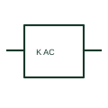

# AC relay coil

An AC relay coil is intended for a specified alternating-current control supply.

[Canonical reference](https://eloragrid.ai/symbols/ac-relay-coil) · [Structured record](../entries/ac-relay-coil.json) · [All references](README.md)

Updated: 2026-10-27. Drawing use: Schematic. Reference families: IEC, Manufacturer.

## What it represents

An AC relay coil is intended for a specified alternating-current control supply. Voltage and frequency form part of its coil rating and cannot be inferred from the relay tag.

## How to read it

- Identify the actual control-supply frequency and voltage.
- The preview is an original explanation of this function. Match the actual drawing convention to its legend and the selected equipment documentation.

## Drawing checklist

- State coil voltage and frequency
- Label coil terminals
- Link contact references

## Important distinction

AC coil suitability does not mean its contacts can switch every AC or DC load.

## Facts

- Drawing role: Relay operation
- Representation scope: Functional concept; not an official standard graphic or a product footprint
- Public vendor block reference: HCR1AC, VCR1AC (Autodesk identifiers; not IEC symbol numbers)
- Identifier status: The short label is a functional lookup label, not an assigned IEC or IEEE symbol number. Any separately listed Autodesk code is a verified vendor block name.

## Public references

- [Relays and contacts: public symbol reference](https://help.autodesk.com/cloudhelp/2021/ENU/AutoCAD-Electrical/files/GUID-011C62B8-9EC8-485C-B47D-B22A3F7B7574.htm) — Autodesk. Public documentation of this equipment function or named vendor variant; the illustration is independently authored and is not the source graphic.

## Related references

- [Relay coil](relay-coil.md)
- [Normally open contact](normally-open-contact.md)

Original educational concept geometry, CC BY 4.0. Unitless; not a certified standards glyph or manufacturer footprint.

Elora-authored explanations are CC BY 4.0. Linked standards and manufacturer material retain their own rights. Confirm project requirements using primary sources.
