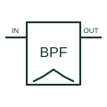

# Active band-pass filter

Passes an intended frequency band while attenuating content below and above that band.

[Canonical reference](https://eloragrid.ai/symbols/active-band-pass-filter) · [Structured record](../entries/active-band-pass-filter.json) · [All references](README.md)

Updated: 2026-10-27. Drawing use: Schematic. Reference families: Manufacturer.

## What it represents

Passes an intended frequency band while attenuating content below and above that band.
On a schematic, identify the lower/upper response boundaries, order and gain definition and trace the selected-band output and receiving measurement circuit. Keep the component tag and signal/reference names consistent across the control drawing, terminal schedule and device documentation.
A band-pass filter selects a band; a notch filter instead rejects a defined band or frequency region.
The preview is an independently drawn educational functional reference. Add the selected component’s actual power pins, terminal numbers, timing or analogue reference details when producing a construction drawing.

## How to read it

- Identify the lower/upper response boundaries, order and gain definition.
- Trace the selected-band output and receiving measurement circuit.

## Drawing checklist

- Label the lower/upper response boundaries, order and gain definition.
- Cross-reference the selected-band output and receiving measurement circuit.
- Add the selected device or circuit documentation revision, power/reference connections and project signal convention.

## Important distinction

A band-pass filter selects a band; a notch filter instead rejects a defined band or frequency region.

## Facts

- Common schematic mnemonic: BPF — descriptive only; project/device documentation defines reference designations.
- Terminal / interface focus: The lower/upper response boundaries, order and gain definition
- Artwork scope: Original educational functional/circuit reference; not a selected product pinout.

## Public references

- [Basic Linear Design, Chapter 8: analogue filter response families](https://www.analog.com/media/en/training-seminars/design-handbooks/Basic-Linear-Design/Chapter8.pdf) — Analog Devices. Public primary manufacturer documentation establishes the component function or circuit/topology relationship. Preview geometry and drafting explanations are independently authored.

## Related references

- [Active notch filter](active-notch-filter.md)
- [PLC input / output](plc-io.md)

Original educational concept geometry, CC BY 4.0. Unitless; not a certified standards glyph or manufacturer footprint.

Elora-authored explanations are CC BY 4.0. Linked standards and manufacturer material retain their own rights. Confirm project requirements using primary sources.
