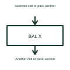

# Active battery cell balancer

An active balancer transfers energy between selected parts of a battery system.

[Canonical reference](https://eloragrid.ai/symbols/active-cell-balancer) · [Structured record](../entries/active-cell-balancer.json) · [All references](README.md)

Updated: 2026-10-27. Drawing use: Schematic. Reference families: Manufacturer.

## What it represents

An active balancer transfers energy between selected parts of a battery system.
A converter-based balancing path can move energy rather than only dissipating it in a resistor.
Identify the cell or pack sections between which energy can move, together with the balancing controller. The distinguishing feature is an energy-transfer circuit, not just a measurement of unequal cell voltages. Draw its power-transfer path separately from the information used to decide when to balance. This is original functional artwork, not a certified standard graphic or device pinout.

## How to read it

- Identify the source and destination of transferred energy.
- Show the selected converter or switching arrangement.
- Reference the controller’s cell-selection and operating conditions.
- The energy-transfer path and control method depend on the selected balancing design.

## Drawing checklist

- Identify the source and destination of transferred energy.
- Show the selected converter or switching arrangement.
- Reference the controller’s cell-selection and operating conditions.

## Important distinction

The energy-transfer path and control method depend on the selected balancing design.

## Facts

- Representation type: Original functional block; not a certified IEC or IEEE graphic
- Concept input: Selected cell or pack section
- Concept output: Another cell or pack section

## Public references

- [Battery monitors and balancers](https://www.ti.com/product-category/battery-management-ics/battery-monitors-balancers/overview.html) — Texas Instruments. Battery monitors and balancers: public technical context for the named function. Product and compliance details remain with the publisher.

## Related references

- [Battery storage cabinet](battery-cabinet.md)
- [Battery cell voltage monitor](battery-cell-voltage-monitor.md)
- [Passive battery cell balancer](passive-cell-balancer.md)
- [Battery cell temperature monitor](battery-cell-temperature-monitor.md)

Original educational concept geometry, CC BY 4.0. Unitless; not a certified standards glyph or manufacturer footprint.

Elora-authored explanations are CC BY 4.0. Linked standards and manufacturer material retain their own rights. Confirm project requirements using primary sources.
