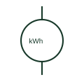

# Active-energy meter

An active-energy meter accumulates active power over time.

[Canonical reference](https://eloragrid.ai/symbols/active-energy-meter) · [Structured record](../entries/active-energy-meter.json) · [All references](README.md)

Updated: 2026-10-27. Drawing use: SLD, Schematic. Reference families: Manufacturer.

## What it represents

An active-energy meter accumulates active power over time. The drawing identifies its voltage and current measurement point, while the register configuration defines import, export or net accumulation.

## How to read it

- Separate direction of accumulated energy from the physical left-to-right drawing direction.
- The preview is an original explanation of this function. Match the actual drawing convention to its legend and the selected equipment documentation.

## Drawing checklist

- Show metering point
- State energy direction convention
- Reference CT/VT ratios

## Important distinction

Kilowatt-hours measure accumulated energy; kilowatts measure active power.

## Facts

- Drawing role: Indicated quantity
- Representation scope: Functional concept; not an official standard graphic or a product footprint
- Identifier status: The short label is a functional lookup label, not an assigned IEC or IEEE symbol number. Any separately listed Autodesk code is a verified vendor block name.

## Public references

- [Power and energy measurement quantities](https://www.se.com/ph/en/faqs/FA343278/) — Schneider Electric. Public documentation of this equipment function or named vendor variant; the illustration is independently authored and is not the source graphic.

## Related references

- [Current transformer](current-transformer.md)
- [Voltage transformer](voltage-transformer.md)
- [Active-power indicator](active-power-indicator.md)

Original educational concept geometry, CC BY 4.0. Unitless; not a certified standards glyph or manufacturer footprint.

Elora-authored explanations are CC BY 4.0. Linked standards and manufacturer material retain their own rights. Confirm project requirements using primary sources.
