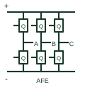

# Active front-end rectifier

An actively switched AC/DC stage using a documented current-control and DC-link regulation arrangement.

[Canonical reference](https://eloragrid.ai/symbols/active-front-end-rectifier) · [Structured record](../entries/active-front-end-rectifier.json) · [All references](README.md)

Updated: 2026-10-27. Drawing use: Schematic, SLD. Reference families: Manufacturer.

## What it represents

An actively switched AC/DC stage using a documented current-control and DC-link regulation arrangement.
On a schematic, identify the AC connection, coupling inductors/filter and active switching bridge and trace the DC-link energy path and front-end control interfaces. Keep the component tag and signal/reference names consistent across the control drawing, terminal schedule and device documentation.
An AFE differs from a passive diode bridge; bidirectional operation and power-factor behaviour depend on the actual system/control implementation.
The preview is a conceptual topology reference rather than a complete power-stage circuit. Switching sequences, magnetic design, component selection and control/protection details belong in the equipment design documentation.

## How to read it

- Identify the AC connection, coupling inductors/filter and active switching bridge.
- Trace the DC-link energy path and front-end control interfaces.

## Drawing checklist

- Label the AC connection, coupling inductors/filter and active switching bridge.
- Cross-reference the DC-link energy path and front-end control interfaces.
- Add the selected device or circuit documentation revision, power/reference connections and project signal convention.

## Important distinction

An AFE differs from a passive diode bridge; bidirectional operation and power-factor behaviour depend on the actual system/control implementation.

## Facts

- Common schematic mnemonic: AFE — descriptive only; project/device documentation defines reference designations.
- Terminal / interface focus: The AC connection, coupling inductors/filter and active switching bridge
- Artwork scope: Original conceptual topology block; not a complete switch-level circuit.

## Public references

- [Bidirectional three-/single-phase AC/DC PFC and inverter application note](https://www.infineon.com/assets/row/public/documents/24/42/infineon-ac-dc-pfc-11-kw-high-efficiency-high-density-bidirectional-three-single-phase-inverter-applicationnotes-en.pdf) — Infineon Technologies. Public primary manufacturer documentation establishes the component function or circuit/topology relationship. Preview geometry and drafting explanations are independently authored.

## Related references

- [Three-phase bridge rectifier](three-phase-bridge-rectifier.md)
- [Power converter / inverter](power-converter.md)

Original educational concept geometry, CC BY 4.0. Unitless; not a certified standards glyph or manufacturer footprint.

Elora-authored explanations are CC BY 4.0. Linked standards and manufacturer material retain their own rights. Confirm project requirements using primary sources.
