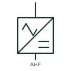

# Active harmonic filter

A shunt converter that measures load harmonics and injects opposing currents to cancel them at the connection point.

[Canonical reference](https://eloragrid.ai/symbols/active-harmonic-filter) · [Structured record](../entries/active-harmonic-filter.json) · [All references](README.md)

Updated: 2026-10-28. Drawing use: SLD, Schematic. Reference families: IEC, IEEE / ANSI.

## What it represents

An active harmonic filter is a shunt-connected voltage-source converter that measures load current through current transformers, calculates the harmonic content and injects equal and opposite currents. It can also correct power factor and balance load between phases. Response adapts to changing loads, so it does not need tuning to particular orders.
Single-line diagrams show a converter block with a wave or harmonic mark, connected to the switchboard bus through a breaker, with current transformers on the load side or on the supply side depending on the control method. Several modules are often paralleled.
The filter rating is in amperes of compensation current, not in kvar, and it can only cancel harmonics within that current and frequency range. The symbol does not tell you where the current transformers are, which decides whether the filter compensates the whole board or one load.

## How to read it

- Find the current transformers; their position defines what is being compensated.
- Ratings are given in compensating amperes.

## Drawing checklist

- State compensating current and harmonic range.
- Show current transformer location.
- Reference parallel module arrangement.

## Important distinction

An active filter cancels harmonics with a converter; a passive filter sinks them with tuned capacitors and reactors.

## Facts

- Core element: Shunt voltage-source converter
- Rating: Compensating current in amperes
- Extra functions: Power factor and load balancing
- Preview: Independent educational illustration; consult the applicable standard and project legend for the exact graphic

## Public references

- [STATCOM: converter-based reactive power compensation](https://www.hitachienergy.com/products-and-solutions/facts/statcom) — Hitachi Energy. Public converter-based compensator page noting active filtering capability.
- [IEC graphical symbols for diagrams](https://tc3.iec.ch/tc-activity/graphical-symbols-for-diagrams/) — IEC. IEC graphical symbol context for converters.

## Related references

- [Single-tuned harmonic filter](single-tuned-harmonic-filter.md)
- [Static synchronous compensator](statcom.md)
- [Active harmonic filter cabinet](ga-active-harmonic-filter-cabinet.md)
- [Current transformer](current-transformer.md)

Original educational concept geometry, CC BY 4.0. Unitless; not a certified standards glyph or manufacturer footprint.

Elora-authored explanations are CC BY 4.0. Linked standards and manufacturer material retain their own rights. Confirm project requirements using primary sources.
