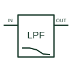

# Active low-pass filter

Passes the intended lower-frequency signal content while attenuating higher-frequency content through an active filter circuit.

[Canonical reference](https://eloragrid.ai/symbols/active-low-pass-filter) · [Structured record](../entries/active-low-pass-filter.json) · [All references](README.md)

Updated: 2026-10-27. Drawing use: Schematic. Reference families: Manufacturer.

## What it represents

Passes the intended lower-frequency signal content while attenuating higher-frequency content through an active filter circuit.
On a schematic, identify the input/output references, filter order and corner-frequency documentation and trace the filtered measurement path and receiving converter. Keep the component tag and signal/reference names consistent across the control drawing, terminal schedule and device documentation.
The LPF label describes a response class; it does not set cutoff, gain, order or component values.
The preview is an independently drawn educational functional reference. Add the selected component’s actual power pins, terminal numbers, timing or analogue reference details when producing a construction drawing.

## How to read it

- Identify the input/output references, filter order and corner-frequency documentation.
- Trace the filtered measurement path and receiving converter.

## Drawing checklist

- Label the input/output references, filter order and corner-frequency documentation.
- Cross-reference the filtered measurement path and receiving converter.
- Add the selected device or circuit documentation revision, power/reference connections and project signal convention.

## Important distinction

The LPF label describes a response class; it does not set cutoff, gain, order or component values.

## Facts

- Common schematic mnemonic: LPF — descriptive only; project/device documentation defines reference designations.
- Terminal / interface focus: The input/output references, filter order and corner-frequency documentation
- Artwork scope: Original educational functional/circuit reference; not a selected product pinout.

## Public references

- [Basic Linear Design, Chapter 8: analogue filter response families](https://www.analog.com/media/en/training-seminars/design-handbooks/Basic-Linear-Design/Chapter8.pdf) — Analog Devices. Public primary manufacturer documentation establishes the component function or circuit/topology relationship. Preview geometry and drafting explanations are independently authored.

## Related references

- [Active high-pass filter](active-high-pass-filter.md)
- [PLC input / output](plc-io.md)

Original educational concept geometry, CC BY 4.0. Unitless; not a certified standards glyph or manufacturer footprint.

Elora-authored explanations are CC BY 4.0. Linked standards and manufacturer material retain their own rights. Confirm project requirements using primary sources.
