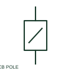

# Additional circuit-breaker pole

An additional pole is a separately drawn part of a multipole circuit breaker.

[Canonical reference](https://eloragrid.ai/symbols/additional-circuit-breaker-pole) · [Structured record](../entries/additional-circuit-breaker-pole.json) · [All references](README.md)

Updated: 2026-10-27. Drawing use: SLD, Schematic. Reference families: IEC, Manufacturer.

## What it represents

An additional pole is a separately drawn part of a multipole circuit breaker. Parent and child representations retain a shared device identity while allowing the phase conductors to appear on separate schematic lines.

## How to read it

- Verify common operation and the shared breaker tag across all poles.
- The preview is an original explanation of this function. Match the actual drawing convention to its legend and the selected equipment documentation.

## Drawing checklist

- Match parent device tag
- Identify pole terminal numbers
- Show common mechanical operation

## Important distinction

A second schematic pole is not a second independently operated breaker.

## Facts

- Drawing role: Circuit interruption
- Representation scope: Functional concept; not an official standard graphic or a product footprint
- Public vendor block reference: HCB2, VCB2 (Autodesk identifiers; not IEC symbol numbers)
- Identifier status: The short label is a functional lookup label, not an assigned IEC or IEEE symbol number. Any separately listed Autodesk code is a verified vendor block name.

## Public references

- [AutoCAD Electrical: Additional circuit-breaker poles](https://help.autodesk.com/cloudhelp/2021/ENU/AutoCAD-Electrical/files/GUID-8B9070E1-A978-429D-A552-27BEFAE1C60E.htm) — Autodesk. Public documentation of this equipment function or named vendor variant; the illustration is independently authored and is not the source graphic.

## Related references

- [Circuit breaker](circuit-breaker.md)
- [AC circuit breaker](52-ac-circuit-breaker.md)

Original educational concept geometry, CC BY 4.0. Unitless; not a certified standards glyph or manufacturer footprint.

Elora-authored explanations are CC BY 4.0. Linked standards and manufacturer material retain their own rights. Confirm project requirements using primary sources.
