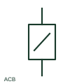

# Air circuit breaker

An ACB is a low-voltage circuit breaker using air as its interrupting medium.

[Canonical reference](https://eloragrid.ai/symbols/air-circuit-breaker) · [Structured record](../entries/air-circuit-breaker.json) · [All references](README.md)

Updated: 2026-10-27. Drawing use: SLD, Schematic. Reference families: IEC, Manufacturer.

## What it represents

An ACB is a low-voltage circuit breaker using air as its interrupting medium. It is frequently used for main incomers or bus couplers and may be fixed or withdrawable.

## How to read it

- The draw-out mechanism, trip unit and main poles are distinct pieces of drawing information.
- The preview is an original explanation of this function. Match the actual drawing convention to its legend and the selected equipment documentation.

## Drawing checklist

- State fixed or withdrawable construction
- Reference main-pole ratings
- Link control and position indication

## Important distinction

ACB denotes an interrupting technology and product family, not a generic synonym for every breaker.

## Facts

- Drawing role: Circuit interruption
- Representation scope: Functional concept; not an official standard graphic or a product footprint
- Identifier status: The short label is a functional lookup label, not an assigned IEC or IEEE symbol number. Any separately listed Autodesk code is a verified vendor block name.

## Public references

- [Circuit breakers and switches](https://www.se.com/au/en/product-category/4200-circuit-breakers-and-switches/) — Schneider Electric. Public documentation of this equipment function or named vendor variant; the illustration is independently authored and is not the source graphic.

## Related references

- [Circuit breaker](circuit-breaker.md)
- [AC circuit breaker](52-ac-circuit-breaker.md)

Original educational concept geometry, CC BY 4.0. Unitless; not a certified standards glyph or manufacturer footprint.

Elora-authored explanations are CC BY 4.0. Linked standards and manufacturer material retain their own rights. Confirm project requirements using primary sources.
