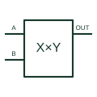

# Analogue multiplier

Produces an analogue output related to the product of two input quantities and the selected scaling/summing arrangement.

[Canonical reference](https://eloragrid.ai/symbols/analog-multiplier) · [Structured record](../entries/analog-multiplier.json) · [All references](README.md)

Updated: 2026-10-27. Drawing use: Schematic. Reference families: Manufacturer.

## What it represents

Produces an analogue output related to the product of two input quantities and the selected scaling/summing arrangement.
On a schematic, identify the two input channels, scaling and any summing/reference terminal and trace the product signal and receiving analogue circuit. Keep the component tag and signal/reference names consistent across the control drawing, terminal schedule and device documentation.
An analogue multiplier processes continuous quantities; it is not a binary full-adder or a simple AND gate.
The preview is an independently drawn educational functional reference. Add the selected component’s actual power pins, terminal numbers, timing or analogue reference details when producing a construction drawing.

## How to read it

- Identify the two input channels, scaling and any summing/reference terminal.
- Trace the product signal and receiving analogue circuit.

## Drawing checklist

- Label the two input channels, scaling and any summing/reference terminal.
- Cross-reference the product signal and receiving analogue circuit.
- Add the selected device or circuit documentation revision, power/reference connections and project signal convention.

## Important distinction

An analogue multiplier processes continuous quantities; it is not a binary full-adder or a simple AND gate.

## Facts

- Common schematic mnemonic: MULT — descriptive only; project/device documentation defines reference designations.
- Terminal / interface focus: The two input channels, scaling and any summing/reference terminal
- Artwork scope: Original educational functional/circuit reference; not a selected product pinout.

## Public references

- [AD633 — analogue multiplication](https://www.analog.com/en/products/ad633.html) — Analog Devices. Public primary manufacturer documentation establishes the component function or circuit/topology relationship. Preview geometry and drafting explanations are independently authored.

## Related references

- [Binary full adder](binary-full-adder.md)
- [PLC input / output](plc-io.md)

Original educational concept geometry, CC BY 4.0. Unitless; not a certified standards glyph or manufacturer footprint.

Elora-authored explanations are CC BY 4.0. Linked standards and manufacturer material retain their own rights. Confirm project requirements using primary sources.
