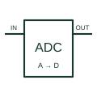

# Analogue-to-digital converter

Converts a sampled analogue quantity into the selected digital representation.

[Canonical reference](https://eloragrid.ai/symbols/analog-to-digital-converter) · [Structured record](../entries/analog-to-digital-converter.json) · [All references](README.md)

Updated: 2026-10-27. Drawing use: Schematic. Reference families: Manufacturer.

## What it represents

Converts a sampled analogue quantity into the selected digital representation.
On a schematic, identify the analogue input, reference, sampling/clock and supply domains and trace the output word or serial interface and data-ready signal. Keep the component tag and signal/reference names consistent across the control drawing, terminal schedule and device documentation.
An ADC block does not define resolution, coding, bandwidth or input limits without the chosen converter documentation.
The preview is an independently drawn educational functional reference. Add the selected component’s actual power pins, terminal numbers, timing or analogue reference details when producing a construction drawing.

## How to read it

- Identify the analogue input, reference, sampling/clock and supply domains.
- Trace the output word or serial interface and data-ready signal.

## Drawing checklist

- Label the analogue input, reference, sampling/clock and supply domains.
- Cross-reference the output word or serial interface and data-ready signal.
- Add the selected device or circuit documentation revision, power/reference connections and project signal convention.

## Important distinction

An ADC block does not define resolution, coding, bandwidth or input limits without the chosen converter documentation.

## Facts

- Common schematic mnemonic: ADC — descriptive only; project/device documentation defines reference designations.
- Terminal / interface focus: The analogue input, reference, sampling/clock and supply domains
- Artwork scope: Original educational functional/circuit reference; not a selected product pinout.

## Public references

- [AD4682 — analogue-to-digital conversion](https://www.analog.com/en/products/ad4682.html) — Analog Devices. Public primary manufacturer documentation establishes the component function or circuit/topology relationship. Preview geometry and drafting explanations are independently authored.

## Related references

- [PLC analog input](plc-analog-input.md)
- [PLC input / output](plc-io.md)

Original educational concept geometry, CC BY 4.0. Unitless; not a certified standards glyph or manufacturer footprint.

Elora-authored explanations are CC BY 4.0. Linked standards and manufacturer material retain their own rights. Confirm project requirements using primary sources.
