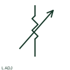

# ANSI/IEEE adjustable-core inductor symbol

IEEE-oriented graphical reference for adjustable-core inductor, with public vendor evidence and drawing-reading notes.

[Canonical reference](https://eloragrid.ai/symbols/ansi-adjustable-core-inductor) · [Structured record](../entries/ansi-adjustable-core-inductor.json) · [All references](README.md)

Updated: 2026-10-27. Drawing use: SLD, Schematic. Reference families: IEEE / ANSI, Manufacturer.

Graphical convention: IEEE / ANSI. Autodesk IEEE-oriented Reactors functional form.

## What it represents

The adjustable inductor form combines a winding with an adjustment function. Its drawing must identify the adjusted parameter and the product's permitted range, rather than interpreting an arrow as a signal connection.
This is a convention-specific lookup based on the publisher's IEEE-labelled preview. The geometry here is independently drawn to explain the connection or operation; it is not a certified reproduction of the standard graphic.

## How to read it

- Separate the adjustment indication from the winding leads.
- Read the selected library and the project legend together. A vendor block identifier is meaningful within its named library and is not a universal standard-symbol code.

## Drawing checklist

- State inductance range
- Identify adjustment method
- Reference component limits

## Important distinction

An adjustment arrow does not represent an extra conducting terminal unless the actual device diagram says so.

## Facts

- Convention evidence: Autodesk IEEE Symbol Preview — Reactors
- Public vendor block name: HRT1L4 (Autodesk identifier; not an IEEE symbol number)
- Standards context: IEEE/ANSI 315-1975 covers diagram graphics. IEEE lists this edition as Inactive-Reserved.
- Artwork scope: Original functional illustration; exact standard glyph and compliance are not certified

## Public references

- [Autodesk IEEE Symbol Preview — Reactors](https://help.autodesk.com/cloudhelp/2021/ENU/AutoCAD-Electrical/files/GUID-2246C552-4410-48FF-9E4B-05B6460B62F7.htm) — Autodesk. Exact public IEEE-oriented category page verifying the component name and vendor block identifier.
- [IEEE/ANSI 315-1975: graphic symbols for electrical and electronics diagrams](https://standards.ieee.org/ieee/315/515/) — IEEE Standards Association. Graphic-symbol standards context and official status; not a source of reproduced artwork.

## Related references

- [Adjustable-core inductor](adjustable-core-inductor.md)
- [Power transformer](power-transformer.md)
- [Capacitor](capacitor.md)

Original educational concept geometry, CC BY 4.0. Unitless; not a certified standards glyph or manufacturer footprint.

Elora-authored explanations are CC BY 4.0. Linked standards and manufacturer material retain their own rights. Confirm project requirements using primary sources.
