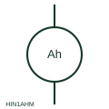

# ANSI/IEEE ampere-hour meter symbol

IEEE-library ampere-hour meter form for integrating charge in DC circuits such as battery and plating supplies.

[Canonical reference](https://eloragrid.ai/symbols/ansi-ampere-hour-meter) · [Structured record](../entries/ansi-ampere-hour-meter.json) · [All references](README.md)

Updated: 2026-10-28. Drawing use: Schematic, SLD. Reference families: IEEE / ANSI, Manufacturer.

Graphical convention: IEEE / ANSI. Autodesk IEEE-oriented Instrumentation and Sensors form: Ampere-Hour meter.

## What it represents

An ampere-hour meter integrates current over time and is most often drawn in DC battery, charger and electrochemical supply circuits. It is normally fed from a shunt, so the schematic should show the shunt, its millivolt rating and the polarity of the sensing leads alongside the meter.
The symbol does not say whether the register counts charge in one direction only or nets charge and discharge. Battery state-of-charge estimation depends on that setting and on efficiency correction, neither of which is visible from the instrument form.

## How to read it

- Find the shunt or sensor that supplies the current signal.
- Confirm whether the register is unidirectional or bidirectional.

## Drawing checklist

- Reference the shunt rating
- Show sensing polarity
- State register direction

## Important distinction

An ampere-hour meter accumulates charge; an ammeter shows instantaneous current and a kWh meter accumulates energy.

## Facts

- Convention evidence: Autodesk IEEE Symbol Preview, Instrumentation and Sensors
- Public vendor block name: HIN1AHM / VIN1AHM (Autodesk identifier; not an IEEE symbol number)
- Typical circuit: DC battery or charger circuit with a measuring shunt
- Artwork scope: Original functional illustration; exact standard glyph and compliance are not certified

## Public references

- [Autodesk IEEE Symbol Preview — Instrumentation and Sensors](https://help.autodesk.com/cloudhelp/2021/ENU/AutoCAD-Electrical/files/GUID-F44D5059-4728-40BD-B9BA-0DE7CFDFAACF.htm) — Autodesk. Public IEEE-oriented Instrumentation and Sensors preview listing the Ampere-Hour meter block and its vendor identifier.
- [IEEE/ANSI 315-1975: graphic symbols for electrical and electronics diagrams](https://standards.ieee.org/ieee/315/515/) — IEEE Standards Association. Graphic-symbol standards context and official status; not a source of reproduced artwork.

## Related references

- [Ampere-hour meter](ampere-hour-meter.md)
- [ANSI/IEEE current-measuring shunt symbol](ansi-current-measuring-shunt.md)
- [ANSI/IEEE ammeter symbol](ansi-ammeter.md)

Original educational concept geometry, CC BY 4.0. Unitless; not a certified standards glyph or manufacturer footprint.

Elora-authored explanations are CC BY 4.0. Linked standards and manufacturer material retain their own rights. Confirm project requirements using primary sources.
