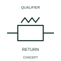

# ANSI/IEEE Automatic mechanical-return indication form

IEEE-library form of automatic mechanical-return indication: this indication identifies the automatic return behaviour of a mechanical control relationship.

[Canonical reference](https://eloragrid.ai/symbols/ansi-automatic-mechanical-return-indication) · [Structured record](../entries/ansi-automatic-mechanical-return-indication.json) · [All references](README.md)

Updated: 2026-10-28. Drawing use: Schematic. Reference families: IEEE / ANSI, Manufacturer.

Graphical convention: IEEE / ANSI. Auto Return.

## What it represents

This reference locates automatic mechanical-return indication in Autodesk's IEEE-oriented mechanical controls family. This indication identifies the automatic return behaviour of a mechanical control relationship. The public library uses Q021207 for its horizontal representation; this is a vendor block name, not an IEEE standards symbol number.
Read the operating mechanism and the contact reference state together. Cross-reference every associated contact to the same device and show which movement, signal or reset changes its condition; the symbol alone does not establish the complete switching sequence.
Show the rest position and the force or condition removed to allow return. Mechanical return behaviour is separate from electrical contact normal state. Show the rest position and the force or condition removed to allow return. Mechanical return behaviour is separate from electrical contact normal state. The linked functional counterpart explains the same operating role in its own drawing context; agreement of every detailed convention mark is not asserted.

## How to read it

- Show the rest position and the force or condition removed to allow return.
- Mechanical return behaviour is separate from electrical contact normal state.

## Drawing checklist

- Identify the associated device, circuit or diagram boundary.
- Show the rest position and the force or condition removed to allow return.
- Cross-reference the equipment data, terminal mapping or operating-state legend needed to interpret the form.

## Important distinction

Mechanical return behaviour is separate from electrical contact normal state.

## Facts

- Convention evidence: Autodesk IEEE Symbol Preview: Mechanical Controls; published form: Auto Return.
- Public vendor block: Q021207. Vendor library token, not an IEEE symbol number.
- Information added: Show the rest position and the force or condition removed to allow return.
- Preview: Independent educational concept; consult the publisher and applicable standard for the exact graphic
- Artwork scope: Original educational geometry. Exact standard graphics, product ratings and terminal pinouts are not certified.

## Public references

- [Autodesk IEEE Symbol Preview: Mechanical Controls](https://help.autodesk.com/cloudhelp/2021/ENU/AutoCAD-Electrical/files/GUID-450F6FD7-7A10-4F81-92A1-0D9BECFB23FC.htm) — Autodesk. Public IEEE-oriented Mechanical Controls table explicitly lists Q021207 as Auto Return. This supports the vendor convention context, not reproduction of the publisher graphic.

## Related references

- [Automatic mechanical-return indication](iec-automatic-mechanical-return-indication.md)
- [Relay coil](relay-coil.md)
- [Normally open contact](normally-open-contact.md)

Original educational concept geometry, CC BY 4.0. Unitless; not a certified standards glyph or manufacturer footprint.

Elora-authored explanations are CC BY 4.0. Linked standards and manufacturer material retain their own rights. Confirm project requirements using primary sources.
