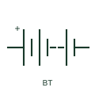

# ANSI/IEEE battery symbol

IEEE-style multi-cell battery drawn as alternating long and short plates, with polarity marked, for American drawing sets.

[Canonical reference](https://eloragrid.ai/symbols/ansi-battery) · [Structured record](../entries/ansi-battery.json) · [All references](README.md)

Updated: 2026-10-28. Drawing use: SLD, Schematic. Reference families: IEEE / ANSI.

Graphical convention: IEEE / ANSI. IEEE-style multi-cell battery with omitted-cell gap.

## What it represents

In IEEE-style drawing sets a battery is drawn as alternating long and short lines, the long line being positive, with either several plate pairs or two pairs separated by a dashed line to show that cells are omitted. The device designation is commonly BT or B rather than the IEC letter G.
The form appears on station DC schematics, control power drawings and microgrid single-line diagrams in North American projects. This is a convention-specific lookup; the geometry here is independently drawn to explain the connection, and is not a certified reproduction of the standard graphic.

## How to read it

- The longer line marks the positive terminal.
- A dashed gap means additional cells not drawn.

## Drawing checklist

- State nominal voltage and ampere-hour capacity.
- Mark polarity.
- Cross-reference the battery charger and DC distribution.

## Important distinction

The IEEE convention uses BT or B as the device letter; the IEC convention uses G for the same battery concept.

## Facts

- Device letter: BT or B in IEEE-style sets
- Standards context: IEEE/ANSI 315-1975 covers diagram graphics. IEEE lists this edition as Inactive-Reserved.
- Artwork scope: Original functional illustration; exact standard glyph and compliance are not certified

## Public references

- [IEEE/ANSI 315-1975: graphic symbols for electrical and electronics diagrams](https://standards.ieee.org/ieee/315/515/) — IEEE Standards Association. IEEE/ANSI graphic-symbol standard status and context; not a source of reproduced artwork.
- [Autodesk IEEE Symbol Preview — Miscellaneous](https://help.autodesk.com/cloudhelp/2021/ENU/AutoCAD-Electrical/files/GUID-34282BFD-7B8E-48F3-A6ED-93ADBDDDFBD3.htm) — Autodesk. Public IEEE-oriented miscellaneous symbol preview page used for convention context.

## Related references

- [Battery](battery.md)
- [Single battery cell](battery-single-cell.md)
- [Float and boost battery charger](float-boost-battery-charger.md)

Original educational concept geometry, CC BY 4.0. Unitless; not a certified standards glyph or manufacturer footprint.

Elora-authored explanations are CC BY 4.0. Linked standards and manufacturer material retain their own rights. Confirm project requirements using primary sources.
