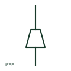

# ANSI/IEEE cable pothead symbol

IEEE-oriented pothead symbol marking a sealed cable termination where an insulated cable meets an overhead line or bus.

[Canonical reference](https://eloragrid.ai/symbols/ansi-cable-pothead) · [Structured record](../entries/ansi-cable-pothead.json) · [All references](README.md)

Updated: 2026-10-28. Drawing use: SLD. Reference families: IEEE / ANSI.

Graphical convention: IEEE / ANSI. Pothead termination form.

## What it represents

Pothead is the traditional North American term for a sealed cable termination, especially at riser poles and outdoor substations. IEEE-style single-line diagrams show it where a cable rises to connect to an overhead line or open bus, often with a lightning arrester beside it.
This illustration is an independent explanation of the convention and is not the IEEE graphic. Modern terminations may be porcelain, polymer or slip-on types, all of which may be called potheads on older drawings. Rating and creepage distance belong in the equipment data.

## How to read it

- Look for an arrester at riser pole potheads.
- Treat older pothead labels as any sealed termination type.

## Drawing checklist

- Identify termination type and rating.
- Show associated arresters.
- Mark phase identification at the pothead.

## Important distinction

A pothead is a fixed sealed termination; a separable connector can be unplugged.

## Facts

- Convention evidence: IEEE 315 graphic conventions for cable terminations (standards context only)
- Terminology: Pothead is the traditional North American term for a sealing end
- Standards context: IEEE/ANSI 315-1975 covers diagram graphics; IEEE lists this edition as Inactive-Reserved.
- Preview: Original educational illustration; consult the publisher and applicable standard for the exact graphic

## Public references

- [IEEE/ANSI 315-1975: graphic symbols for electrical and electronics diagrams](https://standards.ieee.org/ieee/315/515/) — IEEE Standards Association. Graphic-symbol standards context and official status; not a source of reproduced artwork.
- [Elastimold underground cable accessories](https://www.abb.com/global/en/areas/electrification/medium-voltage/cable-accessories-connectors/underground/elastimold/underground) — ABB. Manufacturer context for cable terminations.

## Related references

- [Single-core cable sealing end](iec-single-core-cable-sealing-end.md)
- [ANSI/IEEE surge arrester symbol](ansi-surge-arrester.md)
- [Overhead line](iec-overhead-line.md)

Original educational concept geometry, CC BY 4.0. Unitless; not a certified standards glyph or manufacturer footprint.

Elora-authored explanations are CC BY 4.0. Linked standards and manufacturer material retain their own rights. Confirm project requirements using primary sources.
